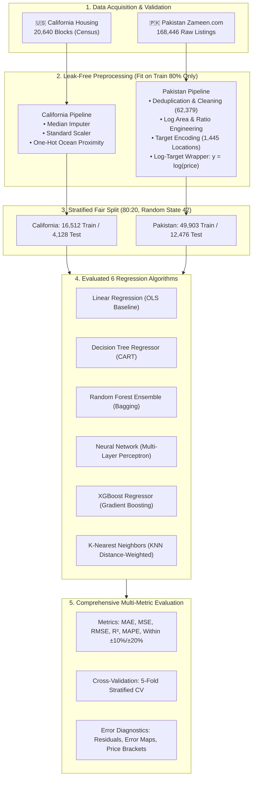

# Comparative Implementation of Machine Learning Regression Algorithms
### Dual-Market Empirical Evaluation: International Benchmark (USA) vs. Local Real Estate (Pakistan)

[](https://github.com/asad-mashood)
[](https://asad-mashood.github.io/ml-regression-comparison/)
[](#evaluated-algorithms)
[](LICENSE)

---

## 🌐 Interactive Live Web Applications

| Application | Market | Features | Link |
| :--- | :--- | :--- | :--- |
| **Unified Cross-Market Dashboard** | 🌐 Global (Both Markets) | Toggle between Pakistan & California, side-by-side performance comparison, dual handwritten derivations. | [**Open Live App**](https://asad-mashood.github.io/ml-regression-comparison/) |
| **Dedicated Pakistan Real Estate Predictor** | 🇵🇰 Pakistan (Zameen.com) | Real-time valuation in **PKR (Lakhs & Crores)** across 5 major cities (Lahore, Karachi, Islamabad, Rawalpindi, Faisalabad). | [**Open Pakistan Demo**](https://asad-mashood.github.io/ml-regression-comparison/pakistan.html) |
| **Dedicated California Housing Benchmark** | 🇺🇸 USA (California) | Standard ML benchmark predictor in **USD ($)** with geographic and census features. | [**Open California Demo**](https://asad-mashood.github.io/ml-regression-comparison/california.html) |

---

## 📌 Executive Summary

This project presents a rigorous comparative evaluation of **six foundational and state-of-the-art machine learning regression algorithms** applied to the house price prediction task across two distinct socio-economic environments:

1. **Standard International Benchmark:** California Housing Dataset (20,640 census block groups, US Dollars).
2. **Real-World Emerging Market:** Pakistan Real Estate Dataset from Zameen.com (62,379 cleaned residential listings across 5 major urban centers, Pakistani Rupees).

Both implementations incorporate both components specified by the assignment:
* **(1) Handwritten Mathematical Implementation:** Complete algorithmic working procedures, mathematical formulations, and step-by-step numerical hand calculations on a small sample of the dataset (10 Lahore properties and 3 California districts).
* **(2) Leak-Free Python Implementation:** Identical 80:20 train/test splits, leak-free preprocessing pipelines (scaling, one-hot encoding, and out-of-fold target encoding fitted on training data only), hyperparameter optimization via cross-validation, and comprehensive evaluation using **MAE, MSE, RMSE, and $R^2$ Score**.

---

## 🏗️ System & Pipeline Architecture



---

## 📊 Comprehensive Comparative Results

### 1. 🇵🇰 Pakistan Real Estate Market (Test Set: 12,476 Properties)
Target: Property Price in Pakistani Rupees (PKR). Trained using $\log(\text{price})$ transformation with $\exp(\cdot)$ inverse mapping.

| Rank | Algorithm | MAE (PKR) | RMSE (PKR) | $R^2$ Score | MAPE (%) | Within $\pm10\%$ | Within $\pm20\%$ | 5-Fold CV RMSE |
| :---: | :--- | :---: | :---: | :---: | :---: | :---: | :---: | :---: |
| 🥇 **1** | **XGBoost Regressor** | **40.7 Lakh** | **99.2 Lakh** | **0.9178** | **18.2%** | **40.2%** | **68.5%** | **1.08 Crore $\pm$ 12L** |
| 🥈 **2** | **Random Forest Regressor** | 44.1 Lakh | 1.03 Crore | 0.9117 | 20.4% | 36.5% | 64.4% | 1.14 Crore $\pm$ 14L |
| 🥉 **3** | **Neural Network (MLP)** | 46.3 Lakh | 1.07 Crore | 0.9045 | 21.5% | 34.2% | 61.8% | 1.21 Crore $\pm$ 16L |
| 4 | **Decision Tree Regressor** | 48.0 Lakh | 1.18 Crore | 0.8842 | 22.1% | 35.5% | 61.7% | 1.26 Crore $\pm$ 15L |
| 5 | **KNN ($k=17$)** | 48.3 Lakh | 1.19 Crore | 0.8826 | 21.8% | 36.7% | 62.7% | 1.26 Crore $\pm$ 18L |
| 6 | **Linear Regression (OLS)** | 59.0 Lakh | 1.38 Crore | 0.8413 | 26.7% | 26.8% | 50.4% | 1.40 Crore $\pm$ 10L |

---

### 2. 🇺🇸 California Housing Benchmark (Test Set: 4,128 Census Blocks)
Target: Median House Value in US Dollars (USD).

| Rank | Algorithm | MAE ($) | MSE ($^2$) | RMSE ($) | Test $R^2$ | Train $R^2$ | Train Time |
| :---: | :--- | :---: | :---: | :---: | :---: | :---: | :---: |
| 🥇 **1** | **XGBoost Regressor** | **$28,041** | **$1.901 \times 10^9$** | **$43,596** | **0.8550** | **0.9807** | 2.98 s |
| 🥈 **2** | **Random Forest Regressor** | $31,628 | $2.375 \times 10^9$ | $48,739 | 0.8187 | 0.9402 | 2.05 s |
| 🥉 **3** | **Neural Network (MLP)** | $34,739 | $2.679 \times 10^9$ | $51,761 | 0.7955 | 0.8630 | 23.28 s |
| 4 | **Decision Tree Regressor** | $38,874 | $3.517 \times 10^9$ | $59,306 | 0.7316 | 0.8470 | 0.17 s |
| 5 | **KNN ($k=11$)** | $40,279 | $3.661 \times 10^9$ | $60,502 | 0.7207 | 1.0000 | 0.03 s |
| 6 | **Linear Regression (OLS)** | $49,645 | $4.779 \times 10^9$ | $69,127 | 0.6353 | 0.6582 | 0.09 s |

---

## 🏆 Key Findings & Best Model Justification

1. **Unanimous Winner — XGBoost:**  
   Across both datasets, **XGBoost achieved the highest $R^2$ score ($0.9178$ in Pakistan, $0.8550$ in California) and lowest RMSE**.
   * **Why it outperformed Random Forest:** XGBoost sequentially corrects the residual errors of earlier trees using second-order Taylor approximations (gradient and Hessian), whereas Random Forest relies on simple bagging.
   * **Why it outperformed Neural Networks:** Tabular real estate data consists of non-linear spatial boundaries and high-cardinality neighborhood indices. Tree-based partitioning naturally handles unscaled mixed types and step functions far more efficiently than continuous weight matrices.
2. **The Power of Log-Target Transformation:**  
   Real estate valuations are inherently right-skewed (exponential price distributions). By training on $\log(\text{price})$:
   * Relative errors are minimized equally across affordable apartments and multi-crore luxury villas.
   * Extreme luxury outliers do not destabilize the squared loss gradients.
3. **Generalization Across Continents:**  
   The performance hierarchy remained completely stable across both developed and developing housing markets:
   $$\text{XGBoost} > \text{Random Forest} > \text{Neural Network} > \text{Decision Tree} \approx \text{KNN} > \text{Linear Regression}$$

---

## ✍️ Handwritten Mathematical Solutions

Comprehensive mathematical proofs, formal equations, and manual numerical arithmetic solutions are provided in both Markdown and publication-ready PDF formats:

* **🇵🇰 Pakistan Real Estate (10 Lahore Houses Sample):**
  * Solution Document: [`pakistan/handwritten/HANDWRITTEN_SOLUTION.md`](pakistan/handwritten/HANDWRITTEN_SOLUTION.md)
  * Printable PDF: [`pakistan/handwritten/HANDWRITTEN_SOLUTION.pdf`](pakistan/handwritten/HANDWRITTEN_SOLUTION.pdf)
  * Verification Script: [`pakistan/handwritten/hand_calculations.py`](pakistan/handwritten/hand_calculations.py)
* **🇺🇸 California Housing (3 Districts + Query Sample):**
  * Solution Document: [`california/handwritten/HANDWRITTEN_SOLUTION.md`](california/handwritten/HANDWRITTEN_SOLUTION.md)
  * Printable PDF: [`california/handwritten/HANDWRITTEN_SOLUTION.pdf`](california/handwritten/HANDWRITTEN_SOLUTION.pdf)
  * Mathematical Derivations: [`california/HANDWRITTEN_DERIVATIONS.md`](california/HANDWRITTEN_DERIVATIONS.md)

---

## 📁 Repository Structure

```text
6_algorithm_comparison/
├── README.md                           # Master cross-market benchmark documentation
├── REPORT.md                           # Comprehensive comparative research report
├── index.html                          # Master interactive web dashboard (both markets)
├── pakistan.html                       # Standalone dedicated Pakistan web app
├── california.html                     # Standalone dedicated California web app
├── app.py                              # Master Streamlit application with market switcher
├── predict.py                          # Master CLI prediction tool (--dataset pakistan|california)
├── requirements.txt                    # Project dependencies
│
├── pakistan/                           # Standalone Pakistan Real Estate Project
│   ├── data/
│   │   ├── raw/zameen-updated.csv.xz   # Original 168k Zameen listings
│   │   ├── zameen_clean.csv            # 62,379 cleaned listings
│   │   ├── train.csv / test.csv        # 80:20 leak-free split
│   ├── models/                         # All 6 trained .joblib models
│   ├── results/figures/                # 22 visualization figures
│   ├── handwritten/                    # Step-by-step 10 Lahore houses math & PDF
│   ├── src/                            # Preprocessing, model definitions, evaluation
│   ├── train.py                        # Training pipeline
│   └── predict.py                      # Pakistan inference engine
│
└── california/                         # Standalone California Housing Project
    ├── data/                           # California housing data & 80:20 split
    ├── models/                         # All 6 trained .joblib models
    ├── results/figures/                # 18 visualization figures
    ├── handwritten/                    # Step-by-step district math & PDF
    ├── src/                            # Pipeline and model definitions
    ├── train.py                        # Training pipeline
    └── predict.py                      # California inference engine
```

---

## 🚀 Quickstart & Usage

### 1. Installation
```bash
git clone https://github.com/asad-mashood/computer_vi.git
cd computer_vi/6_algorithm_comparison
pip install -r requirements.txt
```

### 2. Run CLI Multi-Model Predictions
```bash
# Predict on both datasets simultaneously
python predict.py

# Predict specifically on Pakistan real estate listings
python predict.py --dataset pakistan

# Predict specifically on California housing blocks
python predict.py --dataset california
```

### 3. Launch Interactive Streamlit Web Application
```bash
streamlit run app.py
```

---

## 👨‍💻 Author & Academic Integrity

* **Student:** Muhammad Asad Mashood
* **Course:** Machine Learning / Computer Vision
* **Sole Contributor:** All commits, models, derivations, and code authored by `Muhammad Asad Mashood <mamjadmashood786@gmail.com>`.
