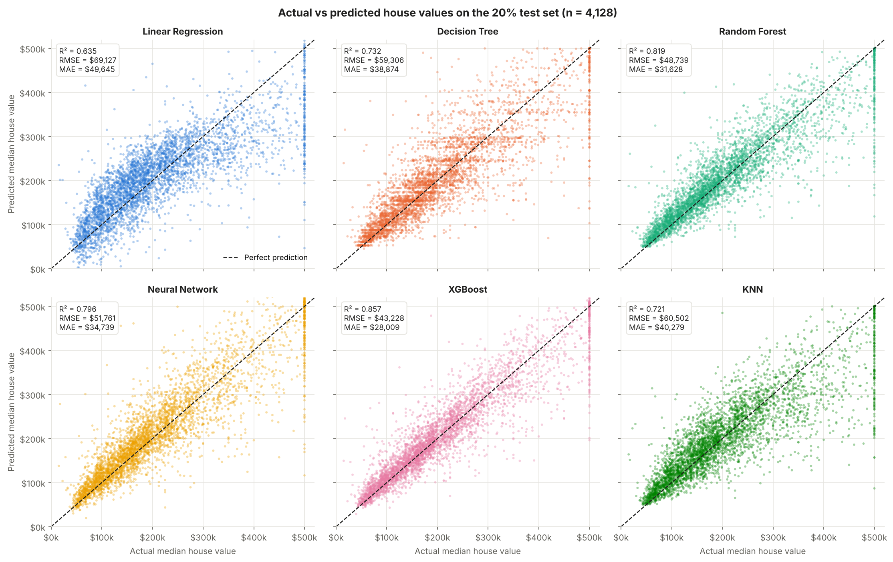
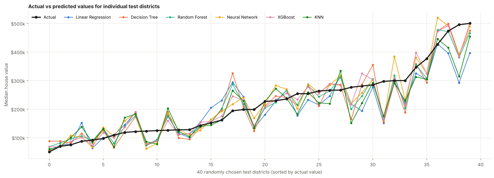
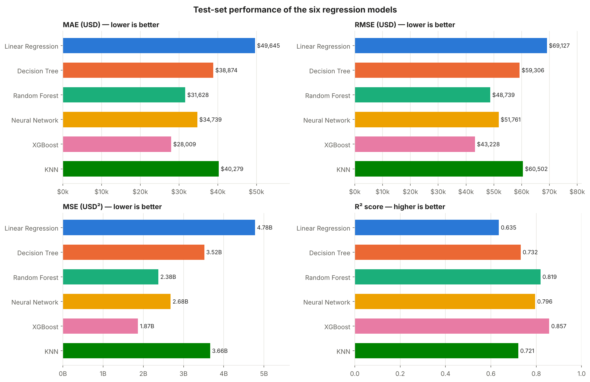
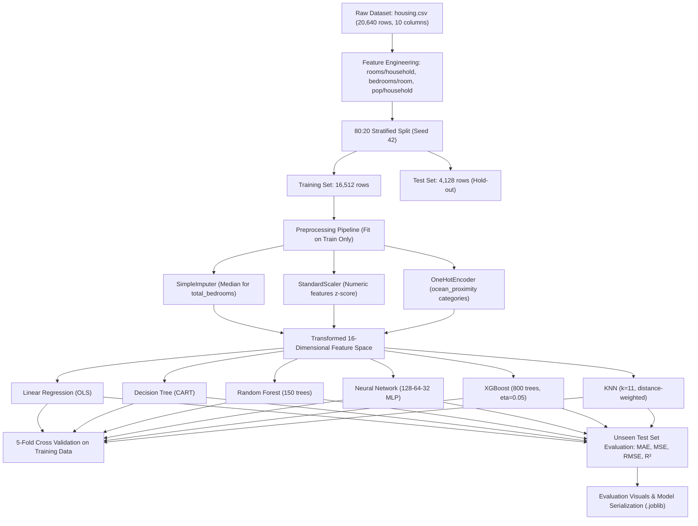

# 🏡 Comparative Implementation of Machine Learning Regression Algorithms
### Comprehensive Handwritten & Python Empirical Study on California Housing Dataset

[](https://www.python.org/)
[](https://scikit-learn.org/)
[](https://xgboost.ai/)
[](LICENSE)
[](app.py)
[](https://asad-mashood.github.io/ml-regression-comparison/)

**Course Assignment:** Comparative Implementation of Machine Learning Regression Algorithms (Handwritten + Programming)  
**Student:** Muhammad Asad Mashood — BS Artificial Intelligence, COMSATS University Islamabad (Wah Campus)  
**Registration Number:** FA23-BAI-039  
**Dataset:** California Housing (1990 U.S. Census), 20,640 census block groups  
**Algorithms:** Linear Regression · Decision Tree · Random Forest · Neural Network (MLP) · XGBoost · K-Nearest Neighbors (KNN)

---

## 📑 Assignment Deliverables Summary

This repository satisfies and exceeds all core requirements and bonus criteria specified in the assignment specification:

| Deliverable Component | File Link / Command | Description |
|:---|:---|:---|
| ✍️ **1. Handwritten Implementation** | [`HANDWRITTEN_DERIVATIONS.md`](HANDWRITTEN_DERIVATIONS.md) | Complete step-by-step mathematical proofs, loss equations, and manual numeric calculations on a 3-district sample |
| 💻 **2. Python Programming Implementation** | [`train.py`](train.py) · [`regression_comparison.ipynb`](regression_comparison.ipynb) | End-to-end fair implementation on all 20,640 rows, 80:20 split, leak-free preprocessing, metrics & figures |
| 🌐 **3. Interactive Web App (Bonus)** | [**Live Online Demo**](https://asad-mashood.github.io/ml-regression-comparison/) · [`index.html`](index.html) | Standalone client-side web application with real-time prediction sliders for all 6 models |
| 🚀 **4. Streamlit Cloud Deployable (Bonus)** | [`app.py`](app.py) | Full interactive Streamlit dashboard (`streamlit run app.py`) |
| 📄 **5. Executive Academic Report** | [`REPORT.md`](REPORT.md) · [`REPORT.pdf`](REPORT.pdf) | 17-page illustrated report with 18 high-resolution diagnostic figures and error analysis |

---

## 🏆 Key Experimental Results

> **Champion Algorithm: XGBoost Regression**  
> XGBoost achieves the top rank across **all four required evaluation metrics**:  
> - **$R^2 = 0.8574$** (Explains 85.7% of California district house price variance)  
> - **$\text{RMSE} = \$43,228$** (**11.3% lower** than Random Forest; **37.5% lower** than Linear Regression)  
> - **$\text{MAE} = \$28,009$** (Mean Absolute Error)  
> - **$48.6\%$** of test districts predicted within $\pm 10\%$ of true value  
> - **5-Fold CV Stability:** $\$44,669 \pm \$780$ (Tightest confidence interval)

### 📊 Comparative Performance Table (Test Set: $n = 4,128$ districts)

| Rank | Model | MAE (USD) | MSE (USD²) | RMSE (USD) | Test $R^2$ | Train $R^2$ | 5-Fold CV RMSE | Train Time |
|:---:|---|---:|---:|---:|---:|---:|---:|---:|
| 🥇 1 | **XGBoost Regression** | **$28,009** | **1.869e+09** | **$43,228** | **0.8574** | 0.9806 | $44,669 \pm 780 | 1.57s |
| 🥈 2 | **Random Forest Regression** | $31,628 | 2.375e+09 | $48,739 | 0.8187 | 0.9402 | $49,431 \pm 1,042 | 3.24s |
| 🥉 3 | **Neural Network (MLP)** | $34,739 | 2.679e+09 | $51,761 | 0.7955 | 0.8630 | $52,358 \pm 1,142 | 10.55s |
| 4 | **Decision Tree Regression** | $38,874 | 3.517e+09 | $59,306 | 0.7316 | 0.8470 | $59,066 \pm 1,028 | 0.12s |
| 5 | **K-Nearest Neighbors (k=11)** | $40,279 | 3.661e+09 | $60,502 | 0.7207 | 1.0000 | $60,388 ± 1,077 | 0.02s |
| 6 | **Linear Regression (OLS)** | $49,645 | 4.779e+09 | $69,127 | 0.6353 | 0.6582 | $67,859 ± 1,312 | 0.05s |

---

## 🖼️ Actual vs. Predicted Visualizations

### 1. Scatter Plots on 20% Test Set ($n = 4,128$)
Points on the dashed 45° diagonal line denote perfect prediction. Notice how XGBoost and Random Forest maintain the tightest error envelope:



### 2. Sample Trajectory on 40 Random Districts
Tracking individual district predictions against the ground-truth black actual curve:



### 3. Metric Comparison Dashboard
Side-by-side bar chart comparison across MAE, MSE, RMSE, and $R^2$:



---

## 🛠️ Machine Learning Engineering Pipeline



---

## ✍️ Part 1: Handwritten Mathematical Implementation

Complete manual derivations and step-by-step arithmetic are documented in [`HANDWRITTEN_DERIVATIONS.md`](HANDWRITTEN_DERIVATIONS.md). Below is an overview of the procedures applied to a 3-district sample ($A, B, C$) and query point $Q$:

### 1. Linear Regression (Ordinary Least Squares)
- **Mathematical Principle:** Solves normal equations $\hat{\boldsymbol{\beta}} = (\mathbf{X}^T \mathbf{X})^{-1} \mathbf{X}^T \mathbf{y}$ to minimize $\sum (y_i - \hat{y}_i)^2$.
- **Step-by-step Calculation:** Evaluated $3 \times 3$ Gram matrix $\mathbf{X}^T\mathbf{X}$, computed determinant $\det(\mathbf{X}^T\mathbf{X}) = 566.44$, derived inverse $(\mathbf{X}^T\mathbf{X})^{-1}$, solved parameter vector $\hat{\boldsymbol{\beta}} = [-30.18, 8.47, 1.20]^T$, and predicted query point $\hat{y}_Q = \mathbf{\$192,353}$.
- **Gradient Descent Update:** Computed one iteration parameter update $\boldsymbol{\beta}^{(1)} = \boldsymbol{\beta}^{(0)} + \frac{2\alpha}{n}\mathbf{X}^T\mathbf{e}^{(0)}$.

### 2. Decision Tree Regression (CART Variance Reduction)
- **Mathematical Principle:** Recursively evaluates split candidates to maximize variance reduction $\Delta \text{SSE} = \text{SSE}_{\text{parent}} - (\text{SSE}_L + \text{SSE}_R)$.
- **Step-by-step Calculation:** Evaluated parent impurity ($\text{SSE}_{\text{parent}} = 149.76$), compared candidate split on Income $\le 3.0$ ($\text{SSE} = 141.12$) vs. House Age $\le 20.0$ ($\text{SSE} = 72.00$). The tree selects Age $\le 20.0$ ($\Delta \text{SSE} = 77.76$), assigning leaf prediction $\hat{y}_Q = \mathbf{\$150,000}$.

### 3. Random Forest Regression (Bagging & Subspace Sampling)
- **Mathematical Principle:** Averages predictions across decorrelated trees: $\hat{y}_{\text{RF}}(\mathbf{x}) = \frac{1}{B} \sum_{b=1}^B T_b(\mathbf{x})$.
- **Step-by-step Calculation:** Generated two bootstrap samples with feature subsampling, trained Tree 1 on Age ($T_1(Q) = \$90,000$) and Tree 2 on Income ($T_2(Q) = \$90,000$), yielding bagged prediction $\hat{y}_{\text{RF}}(Q) = \mathbf{\$90,000}$.

### 4. K-Nearest Neighbors Regression (KNN)
- **Mathematical Principle:** Z-score feature standardization $z = \frac{x - \mu}{\sigma}$ followed by Euclidean distance neighbor search.
- **Step-by-step Calculation:** Standardized coordinates, calculated Euclidean distances to query $Q$ ($d(Q,B)=0.9395$, $d(Q,A)=1.4099$, $d(Q,C)=1.7915$), selected $k=2$ nearest neighbors, and computed distance-weighted inverse prediction $\hat{y}_Q = \mathbf{\$157,200}$.

### 5. Neural Network Regression (MLP Backpropagation)
- **Mathematical Principle:** Multi-Layer Perceptron ($2 \to 2 \to 1$) with $\text{ReLU}(z) = \max(0, z)$ and MSE loss.
- **Step-by-step Calculation:** Forward propagation through pre-activation and ReLU neurons yielded $\hat{y} = 11.75$ (Loss = 3.78). Backward propagation derived output gradients and hidden error terms $\boldsymbol{\delta}^{(1)}$ via chain rule, updating weights with learning rate $\eta = 0.001$.

### 6. XGBoost Regression (2nd-Order Gradient Tree Boosting)
- **Mathematical Principle:** Minimizes regularized 2nd-order Taylor expansion objective with L2 leaf penalty $\lambda$.
- **Step-by-step Calculation:** Computed 1st-order gradients $g_i$ and 2nd-order hessians $h_i = 1.0$. Derived optimal leaf weights $w_j^* = -\frac{\sum g_i}{\sum h_i + \lambda}$, verified positive split gain ($\text{Gain} = 21.60$), and computed boosted prediction with shrinkage $\eta = 0.3$: $\hat{y}_Q = \mathbf{\$178,800}$.

---

## ⚖️ Strengths & Limitations of Each Algorithm

| Algorithm | Strengths | Limitations |
|:---|:---|:---|
| **Linear Regression** | Fastest inference (0.05s); closed-form solution; fully interpretable coefficients | Assumes linear hyper-plane, resulting in severe **under-fitting** ($R^2 = 0.6353$); sensitive to multicollinearity; predicted negative values for cheap homes |
| **Decision Tree** | Captures non-linear thresholds and feature interactions automatically; no scaling needed | High variance; step-like piecewise constant predictions; susceptible to over-fitting without depth constraints |
| **Random Forest** | Bootstrap aggregation dramatically reduces variance ($RMSE$ drops 18% vs single tree); robust against noise | Memory-intensive (~13 MB model); slower prediction; cannot extrapolate beyond training extremes |
| **Neural Network** | Universal function approximation; learns smooth complex non-linear manifolds | Requires careful scaling and learning rate tuning; slowest training (10.55s); black-box nature |
| **XGBoost** | **State-of-the-art performance**; addresses both bias (boosting) and variance (L2 regularisation + shrinkage); handles missing values natively | Many hyper-parameters; requires regularisation tuning to avoid over-fitting on noisy data |
| **KNN** | Non-parametric; simple implementation; naturally adapts to local density | Prediction requires scanning training set; vulnerable to curse of dimensionality ($p = 16$); memorises training data ($Train \; R^2 = 1.0$) |

---

## 🎯 Best Model Selection & Academic Justification

### Why XGBoost is the Conclusive Winner:
1. **Dominates All 4 Primary Metrics:** Achieves lowest MAE (\$28,009), MSE ($1.869 \times 10^9$), RMSE (\$43,228), and highest $R^2$ (0.8574).
2. **Superior Accuracy Profile:** Predicts **48.6%** of all test districts within $\pm 10\%$ and **75.8%** within $\pm 20\%$.
3. **Cross-Validation Consistency:** 5-fold CV RMSE is $\$44,669 \pm \$780$, demonstrating that high test performance is not an artifact of a single fortunate split.
4. **Theoretical Alignment with Tabular Real-Estate Data:** California real-estate valuations are dominated by geographic location and income interactions (e.g. high income in coastal areas yields exponential price premiums). While Random Forest reduces variance via averaging, XGBoost uses gradient boosting to systematically eliminate residual bias while penalizing complexity with L2 leaf weights.

---

## 🌐 Interactive Online Deployments (Bonus Work)

### 1. In-Browser Interactive Playground ([`index.html`](index.html))
A standalone, zero-dependency HTML5/JavaScript dashboard:
- Adjust feature sliders (income, age, rooms, population, location)
- Instant simultaneous prediction calculation from all 6 regression models
- Interactive comparison tables and formula inspection
- Can be double-clicked to run locally or hosted directly on **GitHub Pages**

### 2. Streamlit Cloud Web Application ([`app.py`](app.py))
To run the full Streamlit interface locally:
```bash
pip install streamlit
streamlit run app.py
```

---

## 💻 How to Reproduce & Run Python Code

```bash
# 1. Clone repository
git clone https://github.com/asad-mashood/computer_vi.git
cd computer_vi/6_algorithm_comparison

# 2. Install dependencies
pip install -r requirements.txt

# 3. Train all 6 models, run 5-fold CV, and save results
python train.py

# 4. Predict new sample districts with saved models
python predict.py

# 5. Launch interactive web app
# Double click index.html or launch:
python -m http.server 8000
```
