# House Price Prediction — Comparative Study of Six Regression Algorithms

**Course assignment:** Comparative Implementation of Machine Learning Regression Algorithms  
**Student:** Muhammad Asad Mashood — BS Artificial Intelligence, COMSATS University Islamabad (Wah Campus)  
**Dataset:** California Housing (1990 U.S. Census), 20,640 districts  
**Algorithms:** Linear Regression · Decision Tree · Random Forest · Neural Network (MLP) · XGBoost · K-Nearest Neighbors

> ### Key result
> **XGBoost** is the best model: **R² = 0.857**, **RMSE = \$43,228**, **MAE = \$28,009** on the 4,128-district test set. Its RMSE is **11.3% lower** than the runner-up (Random Forest) and **37.5% lower** than Linear Regression. It predicts 48.6% of districts within ±10% of the true price.

## Contents
1. [Problem statement](#1-problem-statement)
2. [Dataset](#2-dataset)
3. [Exploratory data analysis](#3-exploratory-data-analysis)
4. [Methodology](#4-methodology)
5. [The six algorithms](#5-the-six-algorithms)
6. [Results](#6-results)
7. [Error analysis](#7-error-analysis)
8. [Strengths and limitations](#8-strengths-and-limitations)
9. [Best model and justification](#9-best-model-and-justification)
10. [Conclusion](#10-conclusion)
11. [Reproducing the results](#11-reproducing-the-results)

## 1. Problem statement

Predict the **median house value** of a California district from information about its location, its houses and its residents. This is a **supervised regression** problem because the target is a continuous dollar amount. To compare six regression algorithms fairly, every model uses exactly the same dataset, input features, target variable, preprocessing and **80:20 train/test split**. All six are scored with MAE, MSE, RMSE and R².

## 2. Dataset

- **Source:** California Housing dataset (Pace & Barry, 1997), file `data/housing.csv`
- **Size:** 20,640 rows (one per census block group, i.e. a district) × 10 columns
- **Target:** `median_house_value` in USD (mean \$206,856, range \$14,999 – \$500,001)
- **Missing values:** `total_bedrooms` has 207 missing values; all other columns are complete
- **Note:** the target is **capped at \$500,001** (965 districts). Any district worth more is recorded as \$500,001.

| Column | Type | Meaning | Mean | Min | Max |
|---|---|---|---:|---:|---:|
| `longitude` | numeric | How far west the district is | -119.57 | -124.35 | -114.31 |
| `latitude` | numeric | How far north the district is | 35.63 | 32.54 | 41.95 |
| `housing_median_age` | numeric | Median age of houses (years) | 28.64 | 1.00 | 52.00 |
| `total_rooms` | numeric | Total rooms in the district | 2,635.76 | 2.00 | 39,320.00 |
| `total_bedrooms` | numeric | Total bedrooms in the district | 537.87 | 1.00 | 6,445.00 |
| `population` | numeric | People living in the district | 1,425.48 | 3.00 | 35,682.00 |
| `households` | numeric | Number of households | 499.54 | 1.00 | 6,082.00 |
| `median_income` | numeric | Median household income (tens of thousands USD) | 3.87 | 0.50 | 15.00 |
| `median_house_value` | numeric | **Target**: median house value (USD) | 206,855.82 | 14,999.00 | 500,001.00 |
| `ocean_proximity` | categorical | Location category: <1H OCEAN, INLAND, NEAR OCEAN, NEAR BAY, ISLAND | — | — | — |

**Category counts of `ocean_proximity`:** <1H OCEAN: 9,136, INLAND: 6,551, NEAR OCEAN: 2,658, NEAR BAY: 2,290, ISLAND: 5

## 3. Exploratory data analysis

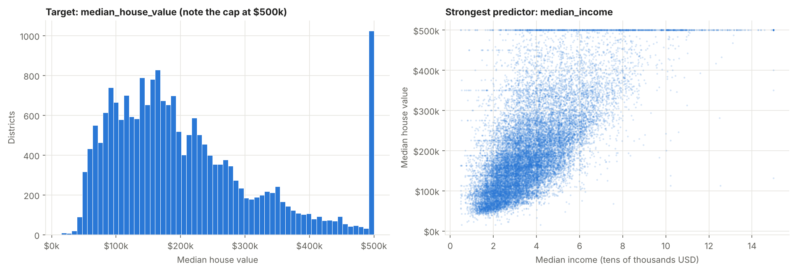

The target is right-skewed and has a spike at the \$500k cap. `median_income` has the strongest relationship with price, but the cloud of points is wide, so income alone cannot explain prices.

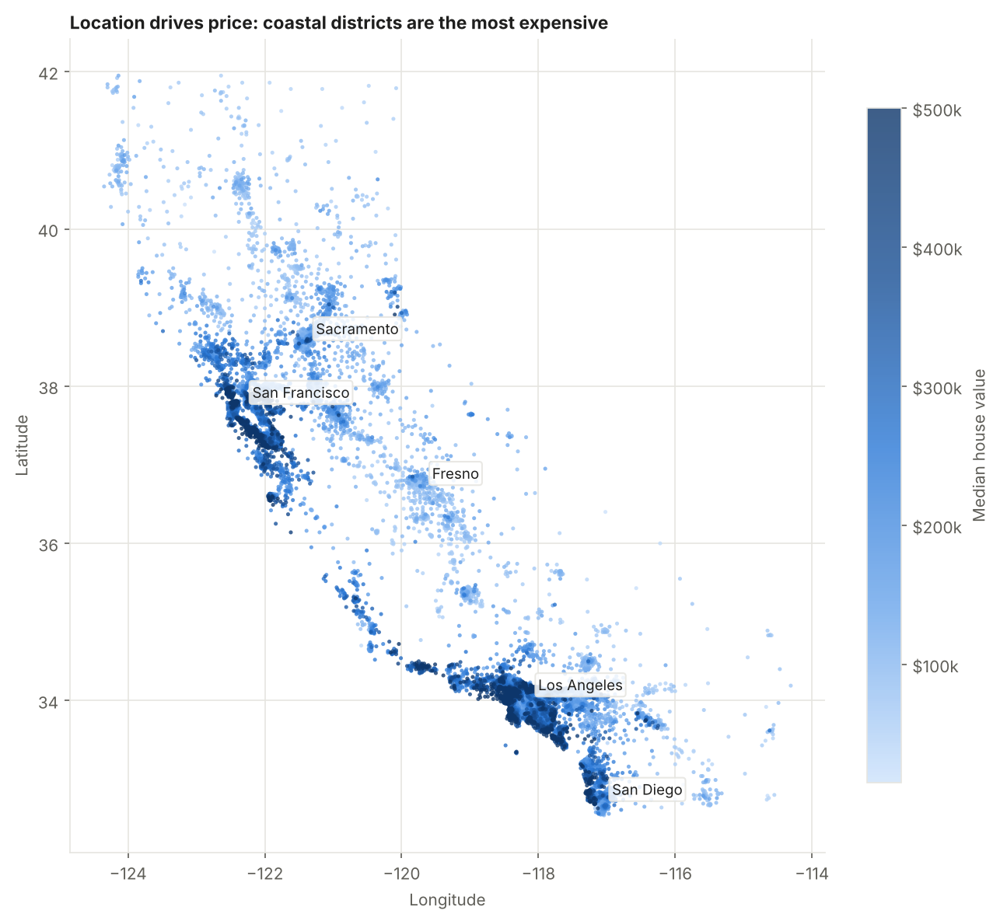

**Location matters a lot.** The most expensive districts lie along the coast around San Francisco, Los Angeles and San Diego, while inland districts (Central Valley) are much cheaper. Price is therefore a **non-linear** function of latitude and longitude, which a straight line cannot capture.

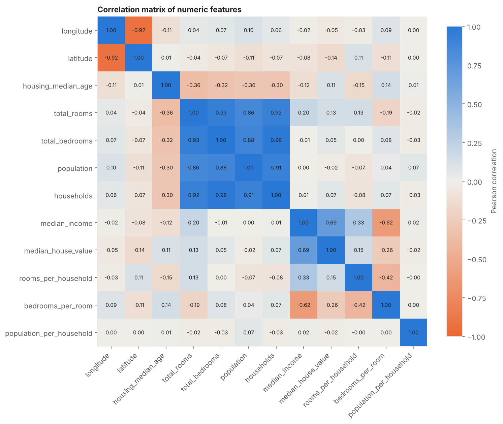

Correlation with the target: `median_income` +0.69, `total_rooms` +0.13, `housing_median_age` +0.11, `households` +0.07, `total_bedrooms` +0.05, `population` -0.02, `longitude` -0.05, `latitude` -0.14. The raw count columns (`total_rooms`, `population`, `households`) are almost perfectly correlated with each other (multicollinearity) and only weakly with price. That is why per-household **ratio features** were engineered.

## 4. Methodology

### 4.1 Pipeline

```
housing.csv ─► feature engineering ─► 80:20 split ─► [ imputer ─► scaler ─► one-hot ] ─► model ─► predictions ─► metrics
                (3 ratio features)    (seed 42)       fitted on the TRAINING set only
```

| Step | What was done | Why |
|---|---|---|
| Feature engineering | `rooms_per_household`, `bedrooms_per_room`, `population_per_household` | Ratios describe a typical home; raw totals mostly measure district size |
| Train/test split | 80% train / 20% test, `random_state=42`, identical for all models | Fair comparison on unseen data |
| Missing values | `total_bedrooms` → median of the training set | Keeps all rows; median is robust to outliers |
| Feature scaling | `StandardScaler`: $z=(x-\mu)/\sigma$ with training mean/std | Required for KNN (distances) and the Neural Network (gradient descent); harmless for trees |
| Encoding | One-hot encoding of `ocean_proximity` (5 binary columns) | Models need numbers; one-hot imposes no false order |
| No data leakage | All preprocessing lives inside an sklearn `Pipeline` fitted on training data only | Test set is never seen during fitting |

Final model input: **16 columns**, made of 11 scaled numeric features and 5 one-hot columns. The exact sets are saved as `data/train.csv` and `data/test.csv`.

### 4.2 Train/test split

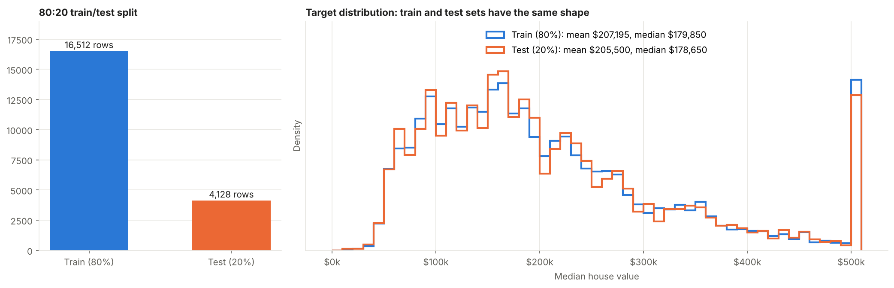

| Set | Rows | Share | Mean price | Median price | Used for |
|---|---:|---:|---:|---:|---|
| Training | 16,512 | 80% | \$207,195 | \$179,850 | fitting models, choosing k, cross-validation |
| Test | 4,128 | 20% | \$205,500 | \$178,650 | final evaluation only |

Both sets have almost the same distribution, so the test set is a fair stand-in for new data.

### 4.3 Evaluation metrics

| Metric | Formula | Meaning |
|---|---|---|
| MAE | $\frac1n\sum\lvert y_i-\hat y_i\rvert$ | Average error in dollars; easy to interpret |
| MSE | $\frac1n\sum (y_i-\hat y_i)^2$ | Squares errors, so large mistakes are punished heavily (units: $²) |
| RMSE | $\sqrt{\text{MSE}}$ | Back in dollars; main ranking metric |
| R² | $R^2=1-\frac{\sum (y_i-\hat y_i)^2}{\sum (y_i-\bar y)^2}$ | Share of price variance explained (1 = perfect, 0 = predicting the mean) |

As extra checks, the report also gives **training R²** (to diagnose over- and under-fitting), **5-fold cross-validated RMSE** on the training set (to show stability), and the **% of districts predicted within ±10% / ±20%**.

## 5. The six algorithms

> [!IMPORTANT]
> **Handwritten Mathematical Implementation & Step-by-Step Derivations:**  
> In accordance with the assignment specifications, full handwritten mathematical procedures, theoretical loss formulations, and complete step-by-step numerical calculations on a sample dataset are documented in:  
> **👉 [HANDWRITTEN_DERIVATIONS.md](HANDWRITTEN_DERIVATIONS.md)**


| Model | Key equation | Settings used |
|---|---|---|
| Linear Regression | $\hat y=\beta_0+\sum_j\beta_jx_j$, $\boldsymbol\beta=(X^TX)^{-1}X^T\mathbf y$ | Ordinary Least Squares |
| Decision Tree | split minimising $SSE_L+SSE_R$; leaf = mean of $y$ | `max_depth=12`, `min_samples_leaf=10` |
| Random Forest | $\hat y=\frac1B\sum_{b=1}^{B}T_b(x)$ (bootstrap + random features) | 150 trees, `max_features=0.5`, `min_samples_leaf=3` |
| Neural Network | $h=\text{ReLU}(Wx+b)$, trained by back-propagation (Adam) | 128-64-32 neurons, `alpha=1e-3`, early stopping |
| XGBoost | $\hat y^{(t)}=\hat y^{(t-1)}+\eta f_t(x)$, $w_j=-\frac{G_j}{H_j+\lambda}$ | 800 trees, η = 0.05, depth 7, subsample 0.8, λ = 1 |
| KNN | $\hat y=$ distance-weighted mean of the $k$ nearest neighbours | k = 11 (chosen by CV), Euclidean |

### Linear Regression: what the model learned
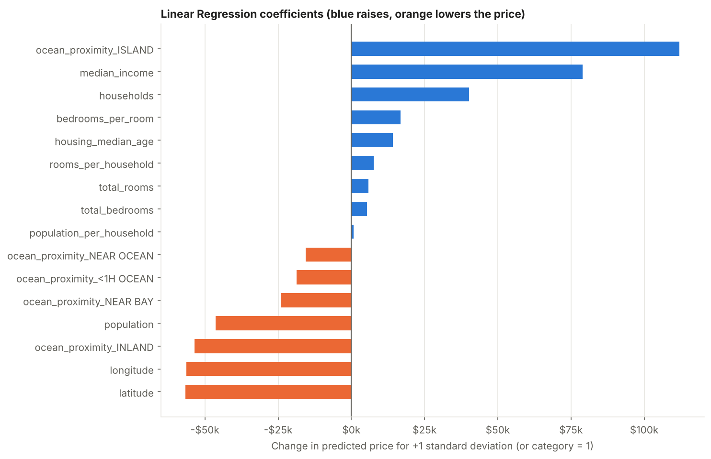

Each bar shows how much the predicted price changes when that feature rises by one standard deviation. Apart from the ISLAND flag, the largest effects come from `median_income`, `latitude`, `longitude`. Income raises the price; inland location and higher latitude/longitude lower it. The ISLAND coefficient is large but rests on only 5 districts, so it is unreliable.

### Decision Tree: the first splits
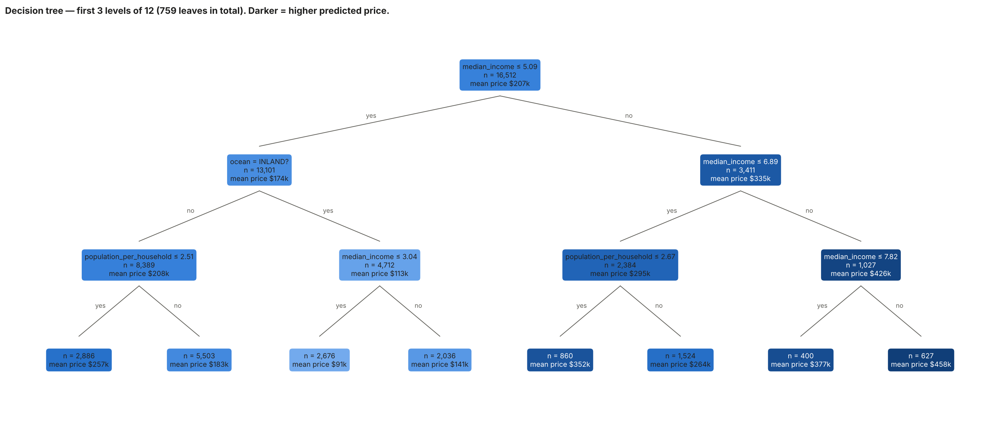

The tree splits first on income, then on inland/coastal location. This is the same logic a human estimator would follow. Thresholds are shown in original units.

### Neural Network: training curve
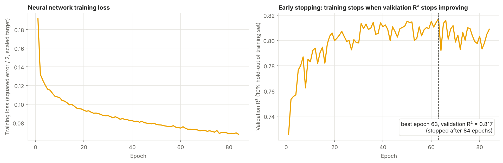

The loss falls steadily. Early stopping keeps the weights from the epoch with the best validation R², which prevents over-fitting.

### Random Forest and XGBoost: feature importance
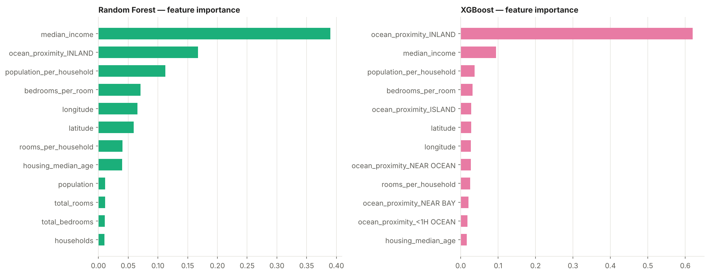

Both ensembles rank **median income** and **inland location** as the most important features, followed by household density and geographic coordinates. This agrees with the exploratory analysis.

### KNN: choosing k
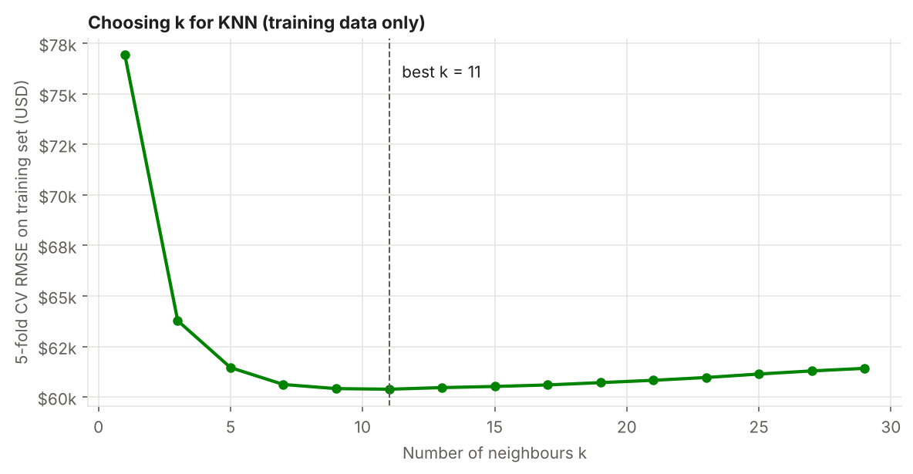

Small k memorises noise and large k over-smooths. Five-fold cross-validation on the training data picked **k = 11**.

## 6. Results

### 6.1 Comparative performance table (test set, 4,128 districts)

| Rank | Model | MAE (USD) | MSE (USD²) | RMSE (USD) | R² | Within ±10% | Within ±20% | Train time (s) |
|---:|---|---:|---:|---:|---:|---:|---:|---:|
| 1 | **XGBoost** | **28,009** | **1.869e+09** | **43,228** | **0.8574** | 48.6% | 75.8% | 1.57 |
| 2 | Random Forest | 31,628 | 2.375e+09 | 48,739 | 0.8187 | 44.3% | 70.5% | 3.24 |
| 3 | Neural Network | 34,739 | 2.679e+09 | 51,761 | 0.7955 | 39.0% | 66.7% | 10.55 |
| 4 | Decision Tree | 38,874 | 3.517e+09 | 59,306 | 0.7316 | 36.7% | 63.0% | 0.12 |
| 5 | KNN | 40,279 | 3.661e+09 | 60,502 | 0.7207 | 34.6% | 60.2% | 0.02 |
| 6 | Linear Regression | 49,645 | 4.779e+09 | 69,127 | 0.6353 | 25.7% | 48.0% | 0.05 |

The ranking is the same for **all four metrics**: XGBoost > Random Forest > Neural Network > Decision Tree > KNN > Linear Regression.

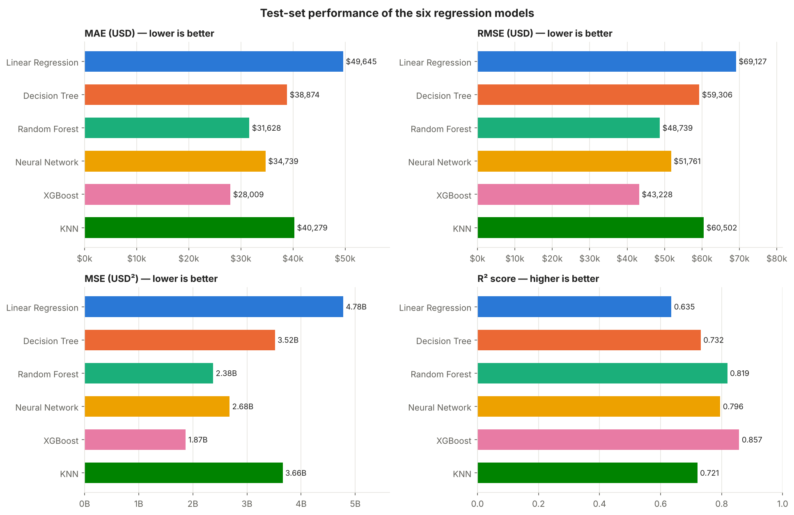

### 6.2 Actual vs predicted values
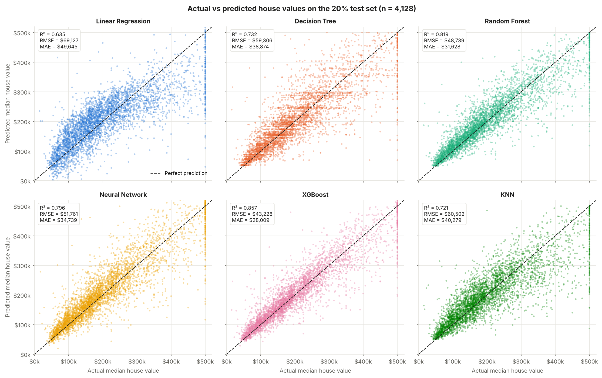

Each dot is one test district, and points on the dashed line are perfect predictions. XGBoost and Random Forest form the tightest band. Linear Regression fans out widely and even predicts negative prices for a few cheap districts. The Decision Tree shows horizontal bands because each leaf predicts one constant value. In every panel, the column of points at \$500k is the capped districts.

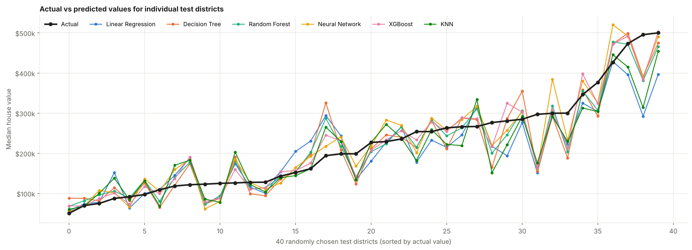

For 40 random test districts, the predictions of the stronger models (XGBoost, Random Forest, Neural Network) stay closest to the black *actual* line.

### 6.3 Over-fitting and stability
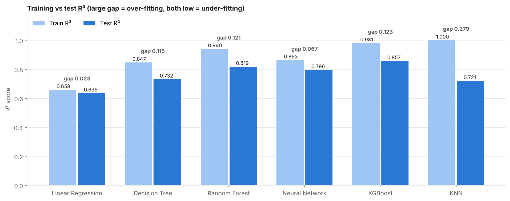

| Model | Train R² | Test R² | Gap | Diagnosis |
|---|---:|---:|---:|---|
| Linear Regression | 0.658 | 0.635 | 0.023 | Under-fitting: both scores low, model too simple |
| Decision Tree | 0.847 | 0.732 | 0.115 | Moderate over-fitting (limited by depth 12) |
| Random Forest | 0.940 | 0.819 | 0.121 | Some over-fitting, but averaging keeps test score high |
| Neural Network | 0.863 | 0.796 | 0.067 | Well balanced (early stopping) |
| XGBoost | 0.981 | 0.857 | 0.123 | Fits training data closely; regularisation keeps the best test score |
| KNN | 1.000 | 0.721 | 0.279 | Memorises training data (each point is its own neighbour) |

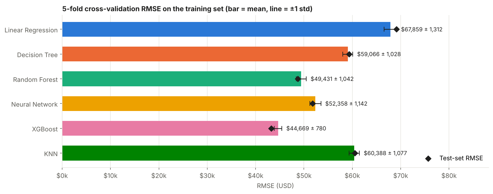

Five-fold cross-validation on the training set gives the same ranking, and every model's test RMSE (black diamond) falls inside or near its CV range. The result does not depend on one lucky split. XGBoost also has the smallest spread (± \$780), so it is the most stable.

## 7. Error analysis

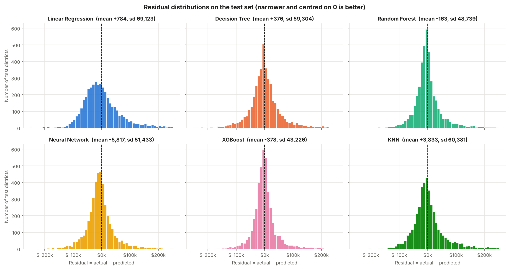

Residuals (actual − predicted) should be centred on 0 and narrow. All models are roughly unbiased. XGBoost has the narrowest distribution, while Linear Regression has the widest.

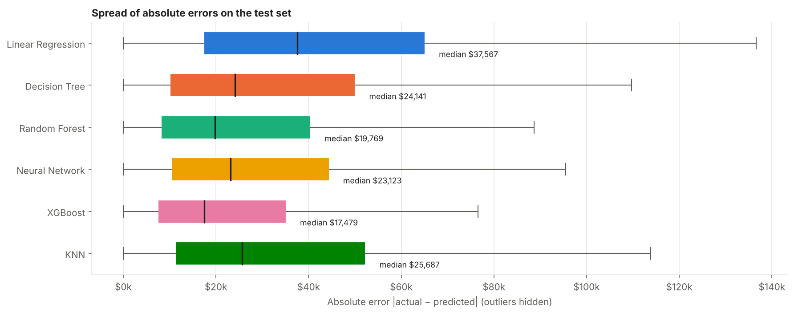

| Model | Median absolute error |
|---|---:|
| XGBoost | \$17,479 |
| Random Forest | \$19,769 |
| Neural Network | \$23,123 |
| Decision Tree | \$24,141 |
| KNN | \$25,687 |
| Linear Regression | \$37,567 |

### Error by price range
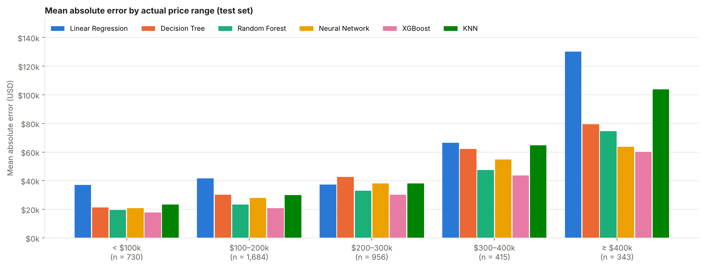

| Price range | Test rows | Linear Regression | Decision Tree | Random Forest | Neural Network | XGBoost | KNN |
|---|---:|---:|---:|---:|---:|---:|---:|
| < \$100k | 730 | \$37,003 | \$21,202 | \$19,580 | \$20,852 | \$17,842 | \$23,463 |
| \$100–200k | 1,684 | \$41,602 | \$30,311 | \$23,425 | \$27,972 | \$20,709 | \$29,894 |
| \$200–300k | 956 | \$37,253 | \$42,723 | \$32,913 | \$38,113 | \$30,296 | \$38,015 |
| \$300–400k | 415 | \$66,507 | \$62,251 | \$47,537 | \$54,836 | \$43,599 | \$64,795 |
| ≥ \$400k | 343 | \$130,183 | \$79,512 | \$74,712 | \$63,794 | \$60,251 | \$103,698 |

Errors grow with price for every model. Expensive districts are rarer (less training data), and the \$500k cap hides their true value. On the 184 capped test districts, the MAE ranges from \$60,126 to \$140,522. XGBoost has the lowest error in every price range.

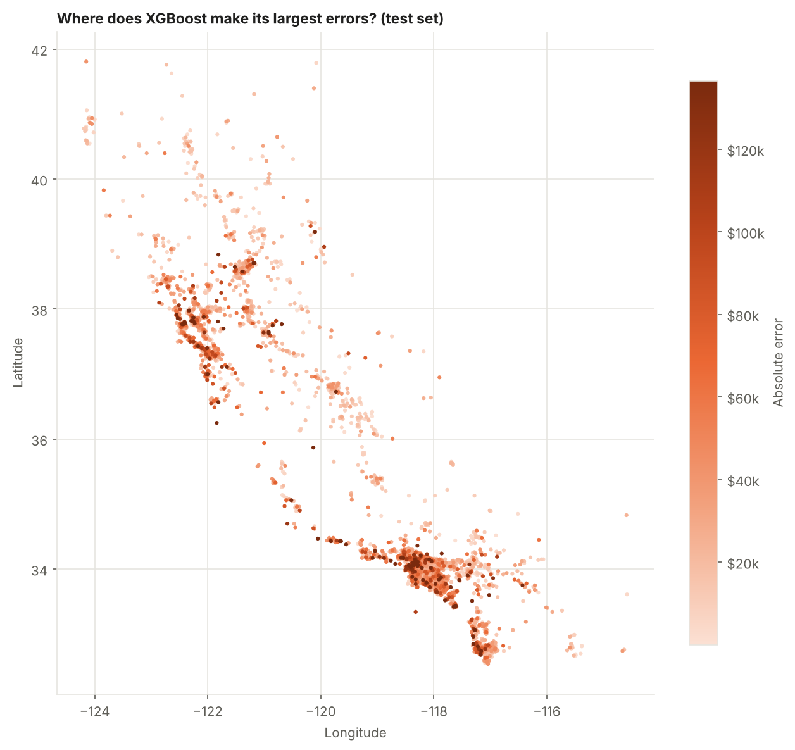

The largest errors of XGBoost cluster in the expensive coastal areas of the Bay Area and Los Angeles. There, neighbouring districts can differ greatly in price for reasons not in the data, such as views, schools or house size.

## 8. Strengths and limitations

| Algorithm | Strengths | Limitations |
|---|---|---|
| **Linear Regression** | Fastest; fully interpretable coefficients; no hyper-parameters; good baseline | Assumes a linear relationship, so it **under-fits** here (R² 0.64); sensitive to outliers and multicollinearity; can predict negative prices |
| **Decision Tree** | Captures non-linearity and interactions; no scaling needed; rules are easy to read | High variance (unstable); step-shaped predictions; over-fits without depth limits |
| **Random Forest** | Averaging many decorrelated trees cuts variance (RMSE 18% lower than a single tree); robust; gives feature importance | Large model file (~18 MB); slower prediction; cannot extrapolate beyond training range |
| **Neural Network** | Learns smooth, complex functions; balanced train/test fit | Needs scaling and careful tuning; slowest to train here; black box; results vary with random initialisation |
| **XGBoost** | Sequential trees fix earlier errors (reduces bias); λ, η and subsampling control variance; fast; handles missing values | Many hyper-parameters; can over-fit without regularisation; less interpretable |
| **KNN** | Simple; no training phase; naturally non-linear | Must scale features; slow prediction on large data; suffers in high dimensions; memorises training set |

## 9. Best model and justification

**XGBoost is the best-performing algorithm.** The evidence:

1. **Best on all four required metrics:** lowest MAE (\$28,009), MSE (1.869e+09) and RMSE (\$43,228), and highest R² (0.8574). It explains 85.7% of the variance in house prices.
2. **Clear margin:** RMSE is 11.3% lower than Random Forest and 37.5% lower than Linear Regression.
3. **Stable:** best 5-fold CV RMSE (\$44,669 ± \$780) with the smallest spread, so the result does not depend on one lucky split.
4. **Most accurate in every price range** and the most districts within ±10% (48.6%).
5. **Practical:** it trains in about 1.6 s, faster than Random Forest and the Neural Network.

**Why it works:** house prices depend non-linearly on income and location, with interactions between them (the same income buys much more inland than on the coast). Tree-based models capture such interactions automatically. Random Forest (bagging) averages independent trees and mainly **reduces variance**. XGBoost (boosting) fits each new tree to the remaining errors (gradients) of the current model, so it also **reduces bias**. Its built-in L2 penalty λ, small learning rate η and row/column subsampling keep that power from turning into over-fitting. Gradient-boosted trees are usually the strongest choice on structured tabular data, and this experiment agrees with that.

## 10. Conclusion

All six algorithms were implemented under identical conditions. The ensemble tree methods clearly beat the single models. XGBoost ranks first (R² 0.857), followed by Random Forest (0.819) and Neural Network (0.796). Linear Regression under-fits (0.635) because the problem is non-linear. All models lose accuracy on expensive homes because of the \$500k cap.

**Possible improvements:** hyper-parameter search (e.g. Optuna), predicting log(price), adding external features (distance to the coast and to city centres), and removing or modelling the capped districts.

## 11. Reproducing the results

```bash
pip install -r requirements.txt
python train.py          # trains the 6 models, writes models/, results/, data/train.csv, data/test.csv
python make_report.py    # rebuilds this report from the results
python predict.py        # loads the saved models and predicts example districts
```

| Output | Content |
|---|---|
| `data/train.csv`, `data/test.csv` | The exact 16,512 / 4,128 rows used for training and testing |
| `models/*.joblib` | The 6 trained models (preprocessing included) |
| `results/metrics.csv` | All metrics for all models |
| `results/test_predictions.csv` | Actual and predicted price for every test district |
| `results/train_predictions.csv` | Actual and predicted price for every training district |
| `results/error_by_price_range.csv` | MAE per price range |
| `results/figures/` | All figures in this report |
