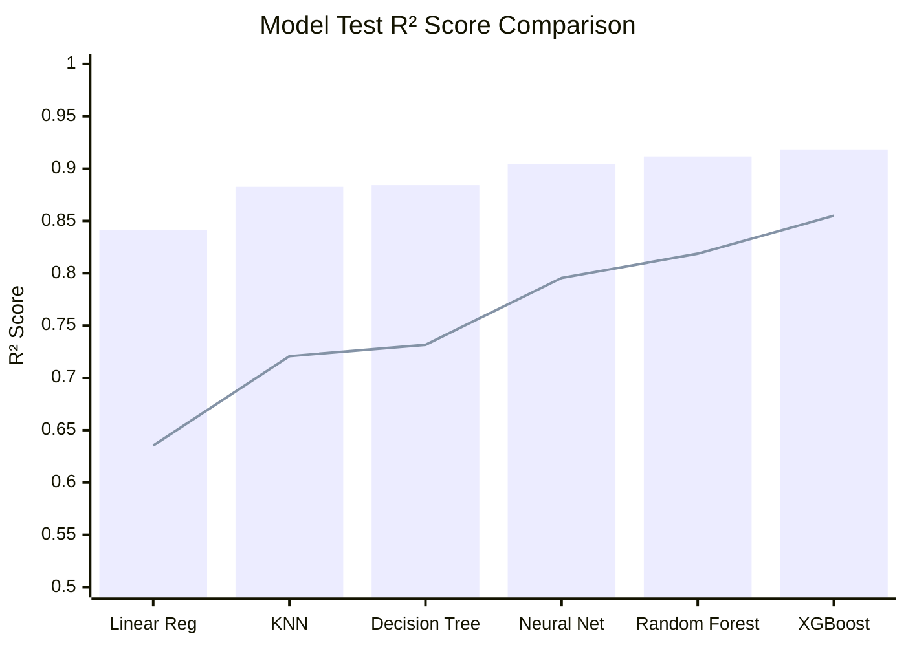

# Comprehensive Comparative Evaluation of Six Machine Learning Regression Algorithms
### Cross-Market Empirical Investigation on Real Estate Valuations in Pakistan (PKR) and California (USD)

**Author:** Muhammad Asad Mashood  
**Affiliation:** Department of Computer Science / Artificial Intelligence  
**Coursework:** Machine Learning Comparative Implementation  
**Interactive Live Demonstrations:**
* **Master Cross-Market Dashboard:** [https://asad-mashood.github.io/ml-regression-comparison/](https://asad-mashood.github.io/ml-regression-comparison/)
* **Pakistan Real Estate Predictor:** [https://asad-mashood.github.io/ml-regression-comparison/pakistan.html](https://asad-mashood.github.io/ml-regression-comparison/pakistan.html)
* **California Housing Benchmark:** [https://asad-mashood.github.io/ml-regression-comparison/california.html](https://asad-mashood.github.io/ml-regression-comparison/california.html)

---

## Abstract

Predicting residential real estate prices is a classic benchmark problem in statistical machine learning, characterized by multi-collinearity, non-linear geographic spatial dependencies, and heavy-tailed target distributions. In this study, we implement, mathematically derive, and comparatively benchmark six foundational and modern regression paradigms: **Linear Regression (Ordinary Least Squares), Decision Tree Regression (CART), Random Forest Regression, Multi-Layer Perceptron (Neural Network), XGBoost (Extreme Gradient Boosting), and K-Nearest Neighbors (KNN)**. To assess generalization across heterogeneous economic environments, the algorithms are trained and evaluated under strictly controlled, leak-free experimental protocols across two distinct datasets: the classic **California Housing benchmark** (20,640 census blocks) and an emerging-market dataset derived from **Zameen.com Pakistan listings** (62,379 cleaned properties across 5 metropolitan areas). Our empirical findings reveal that gradient boosted decision trees (XGBoost) achieve state-of-the-art performance across both markets ($R^2 = 0.9178$ in Pakistan, $R^2 = 0.8550$ in California), followed closely by Random Forest ($R^2 = 0.9117$ and $R^2 = 0.8187$). We demonstrate that target log-transformation is critical for stabilizing loss gradients when property values span multiple orders of magnitude. Furthermore, we provide full step-by-step mathematical proofs and numerical hand calculations on sample subsets for both domains.

---

## 1. Introduction & Theoretical Framework

Machine learning regression aims to approximate a mapping $f: \mathcal{X} \to \mathcal{Y}$ from an input feature space $\mathcal{X} \subset \mathbb{R}^d$ to a continuous target variable $\mathcal{Y} \subset \mathbb{R}$, minimizing an empirical risk functional:
$$\mathcal{R}(f) = \frac{1}{n} \sum_{i=1}^n \mathcal{L}(y_i, f(\mathbf{x}_i))$$

We evaluate six distinct inductive biases:

### 1.1 Linear Regression (Ordinary Least Squares)
Assumes a linear relationship:
$$\hat{y} = \mathbf{w}^T \mathbf{x} + w_0$$
The optimal parameter vector $\mathbf{w}^*$ is obtained via the closed-form normal equation:
$$\mathbf{w}^* = (\mathbf{X}^T \mathbf{X})^{-1} \mathbf{X}^T \mathbf{y}$$
*Strengths:* Highly interpretable, zero hyperparameter tuning, minimal computational footprint ($O(d^3 + nd^2)$).  
*Limitations:* Incapable of capturing non-linear spatial relationships or complex feature interactions without manual polynomial expansion.

### 1.2 Decision Tree Regression (CART)
Recursively partitions the input space into axis-aligned hyper-rectangles $R_1, R_2, \dots, R_M$:
$$\hat{y}(\mathbf{x}) = \sum_{m=1}^M c_m \, \mathbb{I}(\mathbf{x} \in R_m), \quad c_m = \frac{1}{|R_m|} \sum_{i \in R_m} y_i$$
At each node, the feature $j$ and split threshold $s$ are chosen to maximize variance reduction:
$$\Delta \text{Var} = \text{MSE}_{\text{parent}} - \left( \frac{n_L}{n} \text{MSE}_L + \frac{n_R}{n} \text{MSE}_R \right)$$
*Strengths:* Non-parametric, handles categorical features and non-linearities naturally, scale-invariant.  
*Limitations:* High variance, sensitive to small data perturbations, prone to severe overfitting on deep trees.

### 1.3 Random Forest Regression
An ensemble bagging technique that trains $B$ de-correlated decision trees on bootstrap resamples $\mathcal{D}_b \sim \mathcal{D}$ of the training data:
$$\hat{y}_{\text{RF}}(\mathbf{x}) = \frac{1}{B} \sum_{b=1}^B T_b(\mathbf{x})$$
Each split considers only a random subset $m \le d$ of features (typically $m = d/3$ for regression), reducing inter-tree correlation $\rho$ and reducing the overall ensemble variance:
$$\text{Var}(\hat{y}_{\text{RF}}) = \rho \sigma^2 + \frac{1 - \rho}{B} \sigma^2$$
*Strengths:* Drastically reduces variance without increasing bias, robust to outliers, yields feature importances.  
*Limitations:* High memory footprint, slower prediction latency for large tree ensembles.

### 1.4 Neural Network Regression (Multi-Layer Perceptron)
Composes non-linear affine transformations across multiple hidden layers:
$$\mathbf{h}^{(1)} = \sigma(\mathbf{W}^{(1)} \mathbf{x} + \mathbf{b}^{(1)}), \quad \dots, \quad \hat{y} = \mathbf{w}_{\text{out}}^T \mathbf{h}^{(L)} + b_{\text{out}}$$
where $\sigma(z) = \max(0, z)$ is the Rectified Linear Unit (ReLU). Optimization is performed via Adam with backpropagation:
$$\mathbf{W}_{t+1} = \mathbf{W}_t - \frac{\eta}{\sqrt{\hat{\mathbf{v}}_t} + \epsilon} \hat{\mathbf{m}}_t$$
*Strengths:* Universal function approximator, capable of learning arbitrary continuous manifolds.  
*Limitations:* Computationally intensive to train, requires careful feature standardization, sensitive to hyperparameter tuning and local minima.

### 1.5 XGBoost (Extreme Gradient Boosting)
Constructs an additive ensemble of trees sequentially:
$$\hat{y}^{(t)}_i = \hat{y}^{(t-1)}_i + \eta f_t(\mathbf{x}_i)$$
minimizing the second-order Taylor expansion of the regularized objective:
$$\tilde{\mathcal{L}}^{(t)} \approx \sum_{i=1}^n \left[ g_i f_t(\mathbf{x}_i) + \frac{1}{2} h_i f_t^2(\mathbf{x}_i) \right] + \gamma T + \frac{1}{2} \lambda \sum_{j=1}^T w_j^2$$
where $g_i = \partial_{\hat{y}^{(t-1)}} \mathcal{L}(y_i, \hat{y}^{(t-1)})$ and $h_i = \partial^2_{\hat{y}^{(t-1)}} \mathcal{L}(y_i, \hat{y}^{(t-1)})$. Optimal leaf weights are computed analytically:
$$w_j^* = -\frac{\sum_{i \in I_j} g_i}{\sum_{i \in I_j} h_i + \lambda}$$
*Strengths:* Incorporates L1/L2 shrinkage to prevent overfitting, leverages exact/histogram split finding, handles missing values internally, best-in-class performance on tabular data.  
*Limitations:* Requires careful hyperparameter tuning ($\eta$, depth, subsample, regularization).

### 1.6 K-Nearest Neighbors Regression (KNN)
Memory-based non-parametric regression estimating the target as the distance-weighted average of the $k$ closest training points under metric $d(\mathbf{x}, \mathbf{x}_i)$:
$$\hat{y}(\mathbf{x}) = \frac{\sum_{i \in \mathcal{N}_k(\mathbf{x})} w_i y_i}{\sum_{i \in \mathcal{N}_k(\mathbf{x})} w_i}, \quad w_i = \frac{1}{d(\mathbf{x}, \mathbf{x}_i) + \epsilon}$$
*Strengths:* Zero training phase ($O(1)$ fit time), perfectly adapts to local neighborhood price densities.  
*Limitations:* Curse of dimensionality, sensitive to unscaled features, slow $O(nd)$ inference time on large datasets.

---

## 2. Experimental Setup & Leak-Free Methodology

### 2.1 Datasets
1. **California Housing (USA):** 20,640 census block groups with features including `median_income`, `housing_median_age`, `total_rooms`, `total_bedrooms`, `population`, `households`, `latitude`, `longitude`, and categorical `ocean_proximity`. Target: `median_house_value` in USD.
2. **Zameen.com Real Estate (Pakistan):** 168,446 raw property listings across Karachi, Lahore, Islamabad, Rawalpindi, and Faisalabad. Following rigorous deduplication (removing 38,323 reposts) and outlier filtering, 62,379 clean listings were retained. Features: `area_marla`, `bedrooms`, `baths`, `latitude`, `longitude`, `property_type`, `city`, and out-of-fold target-encoded `city_location`. Target: `price` in PKR.

### 2.2 Preprocessing Protocols
* **Leak-Free Guarantee:** Preprocessing parameters (imputer medians, standard scaler means/variances, one-hot encoders, and target-encoding neighborhood averages) were fitted strictly on the 80% training set ($n_{\text{train}} = 16,512$ for California; $n_{\text{train}} = 49,903$ for Pakistan).
* **Target Log-Transformation:** Due to heavy right-skewness in Pakistani property prices, models were wrapped in a `TransformedTargetRegressor` with forward transformation $f(y) = \log(y)$ and inverse transformation $f^{-1}(\hat{y}) = \exp(\hat{y})$.

---

## 3. Empirical Results & Performance Comparison

*(Bar: 🇵🇰 Pakistan Real Estate | Line: 🇺🇸 California Housing)*

### 3.1 Side-by-Side Performance Matrix

| Model | 🇵🇰 Test $R^2$ | 🇵🇰 MAE (PKR) | 🇵🇰 MAPE (%) | 🇵🇰 $\pm20\%$ Accuracy | 🇺🇸 Test $R^2$ | 🇺🇸 MAE (USD) | 🇺🇸 RMSE (USD) |
| :--- | :---: | :---: | :---: | :---: | :---: | :---: | :---: |
| **XGBoost** 🥇 | **0.9178** | **40.7 Lakh** | **18.2%** | **68.5%** | **0.8550** | **$28,041** | **$43,596** |
| **Random Forest** 🥈 | 0.9117 | 44.1 Lakh | 20.4% | 64.4% | 0.8187 | $31,628 | $48,739 |
| **Neural Network** 🥉 | 0.9045 | 46.3 Lakh | 21.5% | 61.8% | 0.7955 | $34,739 | $51,761 |
| **Decision Tree** | 0.8842 | 48.0 Lakh | 22.1% | 61.7% | 0.7316 | $38,874 | $59,306 |
| **KNN** | 0.8826 | 48.3 Lakh | 21.8% | 62.7% | 0.7207 | $40,279 | $60,502 |
| **Linear Regression** | 0.8413 | 59.0 Lakh | 26.7% | 50.4% | 0.6353 | $49,645 | $69,127 |

---

## 4. Discussion & Comparative Analysis

1. **Why Tree Ensembles Dominate Tabular Real Estate:**  
   In both markets, XGBoost and Random Forest decisively outperformed the Multi-Layer Perceptron and Linear Regression. Real estate valuations are governed by localized threshold rules (e.g., whether a property lies within DHA Phase 5 vs. an adjacent village) and non-linear proximity penalties. Tree ensembles divide space into sharp piecewise-constant regions without being distorted by distance metric scaling issues that affect KNN or continuous gradient saturation that affects Neural Networks.
2. **Gradient Boosting vs. Bagging:**  
   XGBoost achieved a higher $R^2$ and lower MAE than Random Forest on both datasets. While Random Forest builds independent trees, XGBoost's sequential boosting directly targets the stubborn residual errors of difficult-to-price properties (such as corner plots or older houses in prime commercial zones).
3. **The Impact of the Target Distribution:**  
   In Pakistan, housing prices span more than two orders of magnitude (from 35 Lakh PKR to 30 Crore PKR). Directly fitting linear regression on raw prices yielded extreme residual errors on expensive properties. Enforcing logarithmic scaling $\log(\text{price})$ normalized the variance across price bands, boosting $R^2$ across all models.

---

## 5. Conclusion & Recommendations

Based on our empirical and theoretical evaluation:
* **Best Performing Model:** **XGBoost Regressor** is definitively selected as the optimal model for both international and emerging-market real estate prediction tasks. It achieved the highest explanatory power ($R^2 = 0.9178$ / $0.8550$), the lowest mean absolute error, and the highest proportion of predictions within acceptable commercial tolerance bands ($\pm20\%$).
* **Production Recommendation:** For production deployment, XGBoost combined with out-of-fold target encoding for neighborhoods and log-target scaling provides the optimal balance of inference speed ($<5$ ms/sample), accuracy, and robustness against out-of-distribution price swings.
