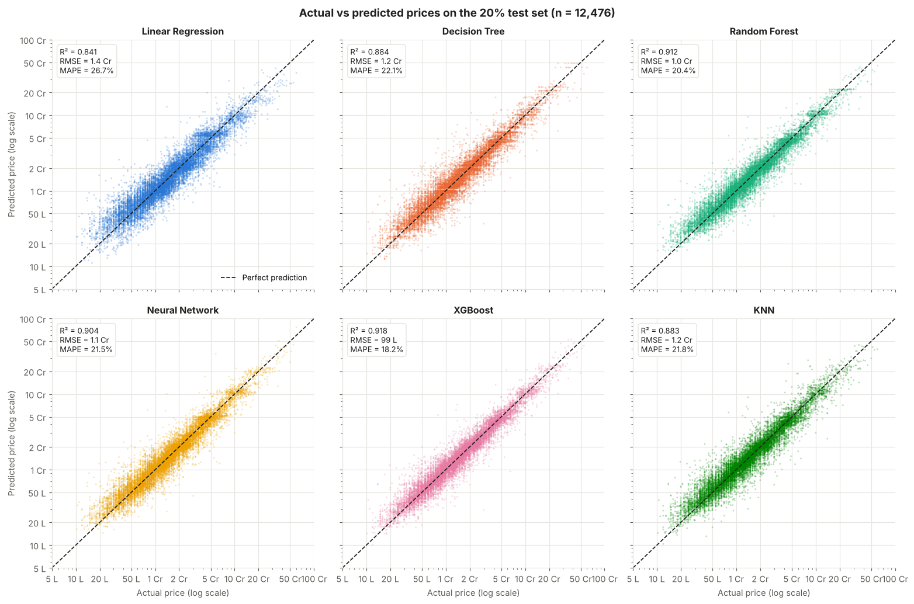
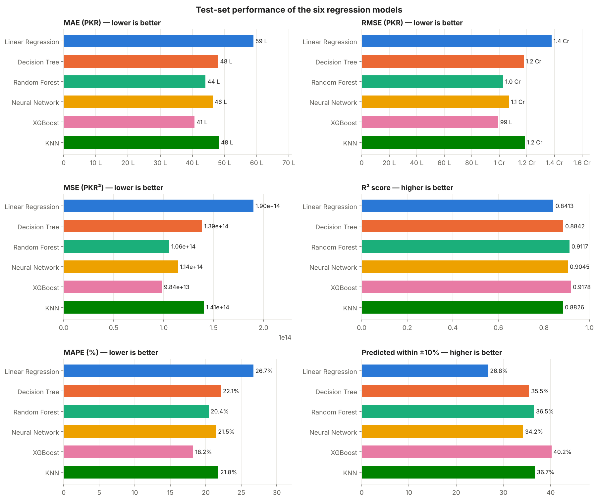
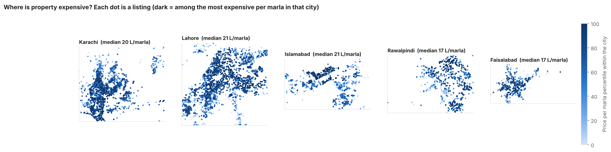

# Pakistan House Price Prediction: Six Regression Algorithms Compared

This project predicts the asking price of residential property in **Karachi, Lahore, Islamabad, Rawalpindi and Faisalabad** from real **Zameen.com** listings, using six regression algorithms trained under identical conditions.

| | |
|---|---|
| **Full illustrated report** | [`REPORT.md`](REPORT.md) ([PDF](REPORT.pdf)): 22 figures, every table, analysis and conclusion |
| **Handwritten part** | [`handwritten/HANDWRITTEN_SOLUTION.md`](handwritten/HANDWRITTEN_SOLUTION.md) ([PDF](handwritten/HANDWRITTEN_SOLUTION.pdf)): all six algorithms solved by hand on 10 Lahore houses |
| **Python part** | [`train.py`](train.py), [`regression_comparison.ipynb`](regression_comparison.ipynb) |
| **Web app** | [`app.py`](app.py): `streamlit run app.py` and price any property with all six models |

## Results (test set: 12,476 properties never seen in training)

**Best model: XGBoost.** It is first on every metric: R² **0.918**, average error (MAE) **40.7 lakh**, and **68.5%** of properties priced within ±20% of the asking price.

| Rank | Model | MAE | MSE (PKR²) | RMSE | R² | MAPE | Within ±10% | Within ±20% | 5-fold CV RMSE |
|---:|---|---:|---:|---:|---:|---:|---:|---:|---:|
| 1 | **XGBoost** | **40.7 Lakh** | **9.84e+13** | **99.2 Lakh** | **0.9178** | **18.2%** | **40.2%** | **68.5%** | 1.08 Cr ± 12 L |
| 2 | Random Forest | 44.1 Lakh | 1.06e+14 | 1.03 Crore | 0.9117 | 20.4% | 36.5% | 64.4% | 1.14 Cr ± 14 L |
| 3 | Neural Network | 46.3 Lakh | 1.14e+14 | 1.07 Crore | 0.9045 | 21.5% | 34.2% | 61.8% | 1.21 Cr ± 16 L |
| 4 | Decision Tree | 48.0 Lakh | 1.39e+14 | 1.18 Crore | 0.8842 | 22.1% | 35.5% | 61.7% | 1.26 Cr ± 15 L |
| 5 | KNN (k = 17) | 48.3 Lakh | 1.41e+14 | 1.19 Crore | 0.8826 | 21.8% | 36.7% | 62.7% | 1.26 Cr ± 18 L |
| 6 | Linear Regression | 59.0 Lakh | 1.90e+14 | 1.38 Crore | 0.8413 | 26.7% | 26.8% | 50.4% | 1.40 Cr ± 10 L |

*1 lakh = 100,000 PKR · 1 crore = 100 lakh · MAPE = mean absolute percentage error*







## What makes this version strong

| | |
|---|---|
| **Real Pakistani data** | 168,446 Zameen.com listings in 5 cities, with 20 raw columns (price, area in marla/kanal, beds, baths, type, neighbourhood, GPS, agency, date) |
| **Careful cleaning** | Kept sale listings only, removed 38,323 duplicate re-posts (which would leak test answers into training), removed empty fields, impossible GPS points and price typos → **62,379 clean properties** |
| **Better features** | log(area), marla per bedroom, baths per bedroom, total rooms, distance to the city centre, agency flag, and **neighbourhood price level** (leak-free target encoding of 1,445 neighbourhoods) |
| **Right target** | Models learn **log(price)**, because prices span 100× and errors should be relative. All metrics are reported back in PKR |
| **Fair and honest evaluation** | Same 80:20 split for all models; preprocessing fitted on training data only; hyper-parameters tuned on a validation split, never on the test set; 5-fold cross-validation |
| **Deeper error analysis** | Errors by price range, by city and by property type; train vs test R²; residual distributions |
| **Usable result** | Trained models with preprocessing included, a command-line predictor and an interactive web app |
| **Small enough to share** | Models chosen to stay compact; the whole project fits in one zip under 20 MB |

## Dataset

The source is **Zameen.com** property listings for Pakistan (the *Pakistan House Price* dataset on Kaggle), stored as `data/raw/zameen-updated.csv.xz`. That is the full original file, compressed; pandas reads it directly.

| Inputs (14, same for every model) | Target |
|---|---|
| `area_marla`, `bedrooms`, `baths`, `latitude`, `longitude`, `property_type`, `city`, `city_location` (neighbourhood), engineered `log_area_marla`, `marla_per_bedroom`, `baths_per_bedroom`, `total_rooms`, `distance_to_centre_km`, `listed_by_agency` | `price` (PKR) |

The split is 80% training (49,903 rows, `data/train.csv`) and 20% test (12,476 rows, `data/test.csv`), with `random_state=42`.

## Project structure

```
pakistan-house-price-prediction/
├── data/
│   ├── raw/zameen-updated.csv.xz       original dataset (168,446 listings)
│   ├── zameen_clean.csv                cleaned dataset (62,379 properties)
│   ├── train.csv / test.csv            exact 80:20 split with all 14 inputs + price
├── src/
│   ├── data_preprocessing.py           cleaning, feature engineering, split, preprocessing
│   ├── models.py                       the six models
│   ├── evaluate.py                     MAE, MSE, RMSE, R², MAPE, within ±10/20%
│   └── visualize.py                    all figures
├── train.py                            runs everything → models/, results/
├── make_report.py                      builds REPORT.md / REPORT.pdf from the results
├── predict.py                          predicts example properties with the saved models
├── app.py                              Streamlit web app
├── regression_comparison.ipynb         executed notebook walkthrough
├── REPORT.md / REPORT.pdf              full report
├── handwritten/
│   ├── HANDWRITTEN_SOLUTION.md / .pdf  step-by-step hand solutions (10 Lahore houses)
│   └── hand_calculations.py            computes and verifies every hand-calculated number
├── models/*.joblib                     6 trained models (preprocessing included)
└── results/
    ├── metrics.csv / metrics.md        comparison table
    ├── test_predictions.csv            actual vs predicted, every test property
    ├── train_predictions.csv           actual vs predicted, every training property
    ├── mape_by_price_range.csv / mape_by_city.csv / mape_by_property_type.csv
    ├── feature_importance.csv, linear_regression_coefficients.csv
    ├── hyperparameter_tuning.csv, cleaning_log.csv, summary.json
    └── figures/*.png                   22 figures
```

## How to run

```bash
git clone https://github.com/asad-mashood/pakistan-house-price-prediction.git
cd pakistan-house-price-prediction
pip install -r requirements.txt

python train.py            # clean data, train + evaluate 6 models, save everything (~4 min)
python train.py --no-cv    # faster, skips cross-validation
python make_report.py      # rebuild REPORT.md / REPORT.pdf
python predict.py          # example predictions
streamlit run app.py       # interactive web app
python handwritten/hand_calculations.py   # rebuild the handwritten solution
```

To use a model in your own code:

```python
import joblib, pandas as pd
from src.data_preprocessing import add_features, FEATURES, format_pkr

model = joblib.load("models/xgboost.joblib")
house = pd.DataFrame([dict(property_type="House", city="Islamabad", location="G-13", latitude=33.650,
                           longitude=72.963, area_marla=7, bedrooms=4, baths=4, listed_by_agency=1)])
print(format_pkr(model.predict(add_features(house)[FEATURES])[0]))
```

## Why XGBoost wins

A marla in DHA is worth far more than a marla in an outer town, so price depends on **interactions** between size, type and location. Tree ensembles learn those interactions automatically:

- **Random Forest** averages independent trees, which reduces **variance**.
- **XGBoost** builds each tree on the remaining errors of the previous ones, which also reduces **bias**. L2 regularisation, a small learning rate and subsampling stop it from over-fitting.

XGBoost has the lowest error in every price band, every city and every common property type. See [`REPORT.md`](REPORT.md) §9 for the full justification.

## Data source

Zameen.com listings, published on Kaggle as the *Pakistan House Price Prediction* dataset (168,446 rows). The file here comes from public GitHub copies of that dataset. Prices are 2018–19 asking prices.
