# Pakistan House Price Prediction: Six Regression Algorithms Compared

**Course assignment:** Comparative Implementation of Machine Learning Regression Algorithms  
**Student:** Muhammad Asad Mashood, BS Artificial Intelligence, COMSATS University Islamabad (Wah Campus)  
**Dataset:** Zameen.com property listings: 168,446 raw listings, cleaned to 62,379 properties for sale in Karachi, Lahore, Islamabad, Rawalpindi and Faisalabad  
**Algorithms:** Linear Regression, Decision Tree, Random Forest, Neural Network (MLP), XGBoost, K-Nearest Neighbors

> ### Key result
> **XGBoost** is the best model on the 12,476-property test set: **R² = 0.918**, **MAE = 40.7 Lakh**, **RMSE = 99.2 Lakh**, typical error (MAPE) **18.2%**. It prices **40%** of properties within ±10% and **69%** within ±20% of the asking price. Its RMSE is 3.5% lower than the runner-up (Random Forest) and 28.0% lower than Linear Regression.

## Contents
1. [Problem statement](#1-problem-statement)
2. [Dataset and cleaning](#2-dataset-and-cleaning)
3. [Exploratory data analysis](#3-exploratory-data-analysis)
4. [Methodology](#4-methodology)
5. [The six algorithms](#5-the-six-algorithms)
6. [Results](#6-results)
7. [Error analysis](#7-error-analysis)
8. [Strengths and limitations](#8-strengths-and-limitations)
9. [Best model and justification](#9-best-model-and-justification)
10. [Conclusion](#10-conclusion)
11. [Using the trained models](#11-using-the-trained-models)
12. [Reproducing the results](#12-reproducing-the-results)

## 1. Problem statement

Estimate the **asking price of a residential property in Pakistan** from what a buyer can see in a listing: size (marla/kanal), bedrooms, baths, property type, city, neighbourhood and GPS location. This is a **supervised regression** problem because the target is a continuous amount in Pakistani Rupees (PKR). Six algorithms are compared under identical conditions: the same data, the same 14 inputs, the same target, the same preprocessing and the same **80:20 train/test split**. They are scored with **MAE, MSE, RMSE and R²**, plus MAPE and the share of properties priced within ±10% and ±20%.

**Units used in this report:** 1 lakh = 100,000 PKR; 1 crore = 100 lakh = 10,000,000 PKR; 1 kanal = 20 marla; 1 marla = 225 sq ft (the Zameen.com convention).

## 2. Dataset and cleaning

### 2.1 Source
The dataset contains listings scraped from **Zameen.com**, Pakistan's largest property portal (listings dated August 2018 to July 2019). It was published on Kaggle as the *Pakistan House Price* dataset. Raw file: `data/raw/zameen-updated.csv.xz` (168,446 rows × 20 columns).

| Raw column | Meaning | Used? |
|---|---|---|
| `property_id` | Listing ID | no |
| `location_id` | Neighbourhood ID | no |
| `page_url` | Listing web address | no |
| `property_type` | House, Flat, Upper/Lower Portion, Penthouse, Farm House, Room | yes |
| `price` | **Target**: asking price (PKR) | target |
| `location` | Neighbourhood / society (e.g. DHA Defence, Bahria Town, G-13) | yes (neighbourhood) |
| `city` | Karachi, Lahore, Islamabad, Rawalpindi, Faisalabad | yes |
| `province_name` | Punjab, Sindh, Islamabad Capital | no |
| `latitude` | GPS latitude | yes |
| `longitude` | GPS longitude | yes |
| `baths` | Number of bathrooms | yes |
| `area` | Size as text, e.g. '10 Marla', '1 Kanal' | no |
| `purpose` | For Sale / For Rent | filter (sale only) |
| `bedrooms` | Number of bedrooms | yes |
| `date_added` | Date the listing was posted | no |
| `agency` | Real-estate agency (if any) | yes, as listed_by_agency flag |
| `agent` | Agent name (if any) | no |
| `Area Type` | Marla or Kanal | yes, converted to marla |
| `Area Size` | Size number | yes, converted to marla |
| `Area Category` | Size band, e.g. '5-10 Marla' | no |

### 2.2 Cleaning
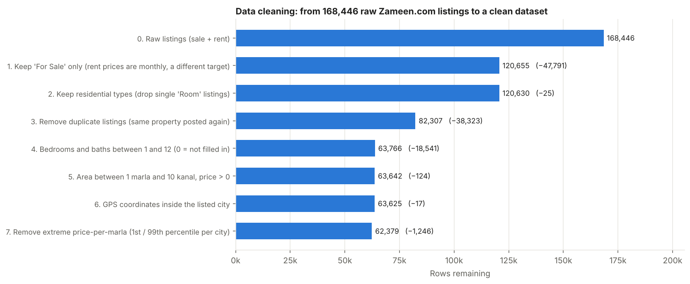

| Step | Rows left | Removed | Why |
|---|---:|---:|---|
| Raw listings | 168,446 |  | sale + rent |
| Keep 'For Sale' only | 120,655 | 47,791 | rent prices are monthly, a different target |
| Keep residential types | 120,630 | 25 | drop single 'Room' listings |
| Remove duplicate listings | 82,307 | 38,323 | same property posted again |
| Bedrooms and baths between 1 and 12 | 63,766 | 18,541 | 0 = not filled in |
| Area between 1 marla and 10 kanal, price > 0 | 63,642 | 124 |  |
| GPS coordinates inside the listed city | 63,625 | 17 |  |
| Remove extreme price-per-marla | 62,379 | 1,246 | 1st / 99th percentile per city |

The biggest removal is **duplicates**: the same property re-posted by different agents. If a copy of a house sits in the training set and another copy in the test set, the model is being tested on a house it has already seen, and the scores look better than they really are. Removing duplicates makes the evaluation honest. Listings with 0 bedrooms or baths mean the seller left the field empty, so those were removed too. The final dataset has **62,379 properties**.

## 3. Exploratory data analysis

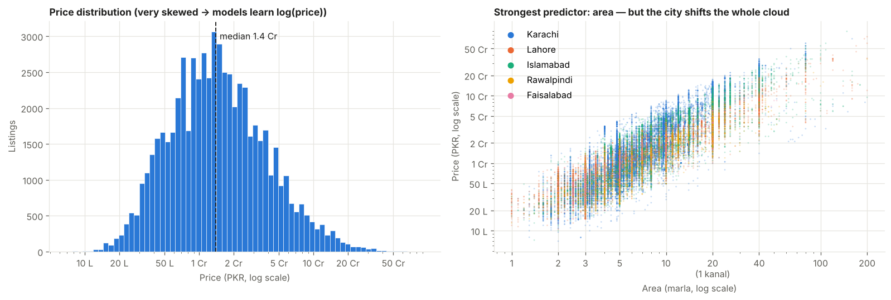

Prices range from 7.0 Lakh to 90.00 Crore, with a median of **1.40 Crore**. The distribution is extremely skewed, so on a log scale it looks almost normal. **Area** is the strongest single predictor: the correlation between log(area) and log(price) is 0.88.

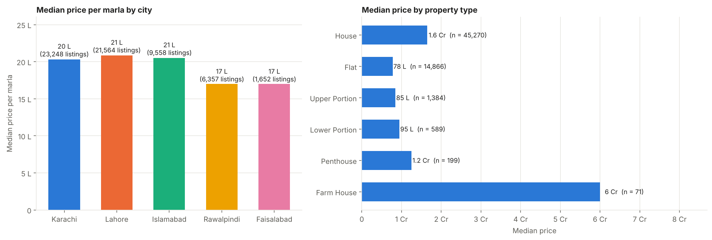

Per marla, Karachi, Lahore and Islamabad are the most expensive cities, while Rawalpindi and Faisalabad are cheaper. Houses dominate the data. Farm houses are the most expensive type because they are very large.

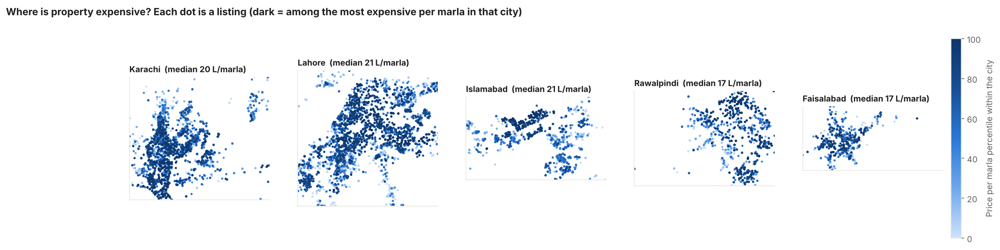

**Location inside a city matters as much as the city itself.** Within each city, the expensive and cheap areas form clear clusters. In Karachi the expensive cluster is DHA, Bath Island and Sea View near the sea; in Islamabad it is the F-6, F-7 and F-8 sectors.

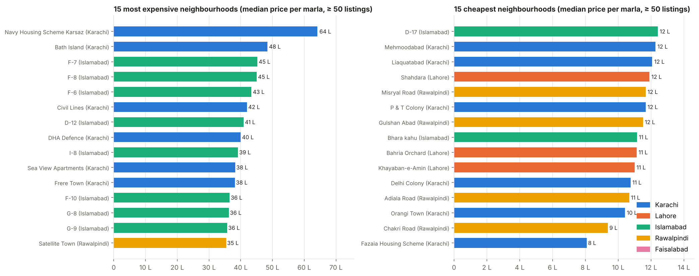

The most expensive and the cheapest neighbourhoods differ by up to **8× in price per marla**. A model therefore needs to know the neighbourhood, not only the city. That is why the `location` column is turned into a numeric *neighbourhood price level* feature (target encoding, section 4).

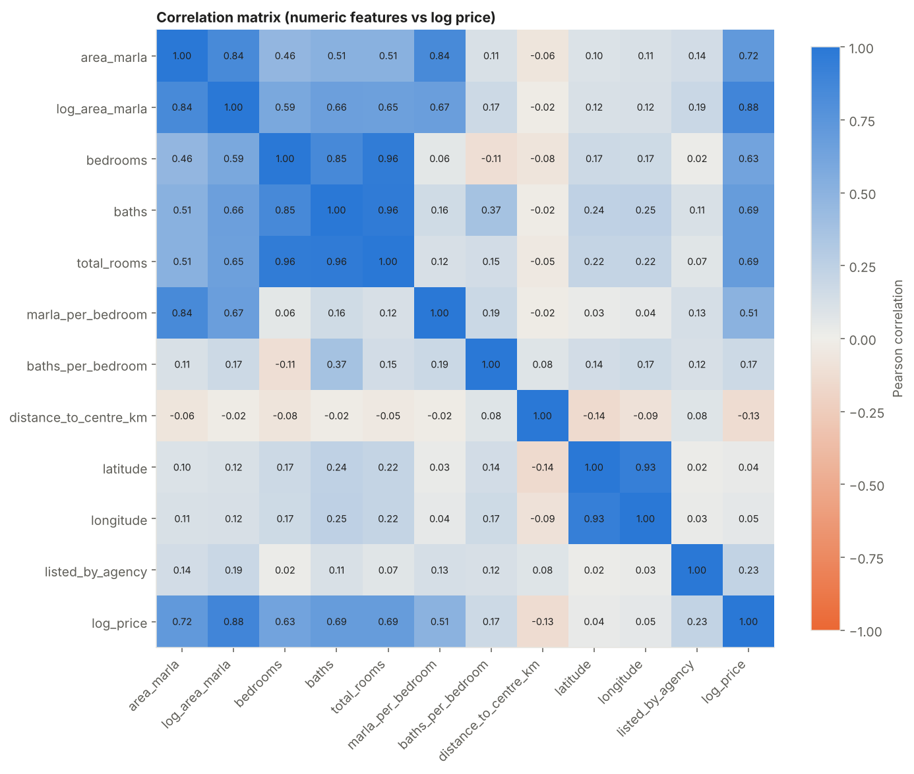

Bedrooms, baths and total rooms are strongly correlated with each other (multicollinearity), and all of them are correlated with area. Latitude and longitude are also correlated with each other. Raw GPS alone says little about price across Pakistan, but it does within a city.

## 4. Methodology

### 4.1 Pipeline
```
zameen-updated.csv.xz → cleaning → feature engineering → 80:20 split → [ scaling | one-hot | target encoding ] → model(log price) → exp → PKR
                                                                         fitted on the TRAINING set only
```

### 4.2 Input features (identical for all six models)
| Feature | Type | Description |
|---|---|---|
| `area_marla` | numeric | Size in marla (kanal × 20) |
| `bedrooms` | numeric | Bedrooms |
| `baths` | numeric | Bathrooms |
| `latitude` | numeric | GPS latitude |
| `longitude` | numeric | GPS longitude |
| `log_area_marla` | engineered | log(area): price grows roughly in proportion to size, which is linear on the log scale |
| `marla_per_bedroom` | engineered | Spaciousness: area ÷ bedrooms |
| `baths_per_bedroom` | engineered | Luxury indicator: baths ÷ bedrooms |
| `total_rooms` | engineered | Bedrooms + baths |
| `distance_to_centre_km` | engineered | Straight-line (haversine) distance to the city centre: Saddar (Karachi), Mall Road (Lahore), Blue Area (Islamabad), Saddar (Rawalpindi), Clock Tower (Faisalabad) |
| `listed_by_agency` | engineered | 1 if a real-estate agency posted the listing |
| `property_type` | categorical → one-hot | House (reference), Flat, Upper Portion, Lower Portion, Penthouse, Farm House |
| `city` | categorical → one-hot | Karachi (reference), Lahore, Islamabad, Rawalpindi, Faisalabad |
| `city_location` | categorical → target encoding | Neighbourhood (1,445 different ones), replaced by its average log-price in the training data |

### 4.3 Preprocessing decisions
| Decision | What | Why |
|---|---|---|
| **Log target** | All models learn $\log(\text{price})$; predictions are converted back with $e^{\hat y}$ | Prices span 100×. On the log scale errors are *relative* (10% on a 50-lakh flat counts the same as 10% on a 10-crore house) and the relationship with log(area) becomes linear |
| **Scaling** | `StandardScaler`, $z=(x-\mu)/\sigma$ | Needed by KNN (distances) and the Neural Network (gradient descent); harmless for trees |
| **One-hot encoding** | `property_type`, `city`, dropping one reference category each | Numbers without a fake order; dropping a reference avoids perfect collinearity in Linear Regression |
| **Target encoding** | `city_location` → smoothed mean log-price of that neighbourhood, computed with 5-fold *cross-fitting* inside the training set | 1,400+ neighbourhoods would mean 1,400+ one-hot columns. Cross-fitting stops a row from seeing its own price, so nothing leaks |
| **No leakage** | Cleaning works row by row; every learned transformation sits inside the model pipeline and is fitted on training data only | The test set stays truly unseen |

### 4.4 Train/test split
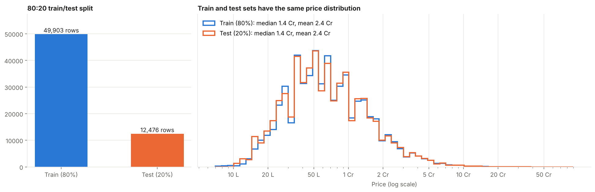

| Set | Rows | Share | Median price | Mean price | Used for |
|---|---:|---:|---:|---:|---|
| Training | 49,903 | 80% | 1.40 Crore | 2.43 Crore | fitting, choosing k, tuning, cross-validation |
| Test | 12,476 | 20% | 1.38 Crore | 2.43 Crore | final evaluation only |

### 4.5 Evaluation metrics
| Metric | Formula | Meaning |
|---|---|---|
| MAE | $\frac1n\sum\lvert y_i-\hat y_i\rvert$ | Average error in rupees |
| MSE | $\frac1n\sum (y_i-\hat y_i)^2$ | Punishes large mistakes heavily (units: PKR²) |
| RMSE | $\sqrt{\text{MSE}}$ | Back in rupees; main ranking metric |
| R² | $R^2=1-\frac{\sum (y_i-\hat y_i)^2}{\sum (y_i-\bar y)^2}$ | Share of price variation explained (1 = perfect) |
| MAPE | $\frac{100}{n}\sum \frac{\lvert y_i-\hat y_i\rvert}{y_i}$ | Typical % error; fair to cheap and expensive properties alike |
| Within ±10% / ±20% | share with $\lvert y-\hat y\rvert / y \le 0.1$ / \$0.2$ | How often the estimate is close enough to be useful |

## 5. The six algorithms

| Model | Key equation | Settings used |
|---|---|---|
| Linear Regression | $\hat y=\beta_0+\sum_j\beta_jx_j$, $\boldsymbol\beta=(X^TX)^{-1}X^T\mathbf y$ | Ordinary Least Squares |
| Decision Tree | split minimising $SSE_L+SSE_R$; leaf = mean of $y$ | `max_depth=14`, `min_samples_leaf=8` |
| Random Forest | $\hat y=\frac1B\sum_b T_b(x)$ (bootstrap + random features) | 80 trees, `max_features=0.4`, `max_leaf_nodes=1200`, `min_samples_leaf=2` |
| Neural Network | $h=\text{ReLU}(Wx+b)$, back-propagation with Adam | 128-64-32 neurons, `alpha=1e-4`, batch 128, early stopping |
| XGBoost | $\hat y^{(t)}=\hat y^{(t-1)}+\eta f_t(x)$, $w_j=-\frac{G_j}{H_j+\lambda}$ | 800 trees, η = 0.05, depth 8, subsample 0.8, colsample 0.7, λ = 1 |
| KNN | distance-weighted mean of the $k$ nearest neighbours | k = 17 (chosen by 5-fold CV), Euclidean |

### 5.1 Hyper-parameter tuning
Settings for the two ensembles were chosen on a **validation split taken from the training set**; the test set was never used for this. The trial results (validation RMSE in lakh) are in `results/hyperparameter_tuning.csv`. Among configurations of almost equal accuracy, the one with the **smaller saved model** was chosen, so the whole project fits on GitHub and in one zip.

| Model | Configuration | Val. RMSE | Val. R² | Val. MAPE | Model size | Chosen |
|---|---|---:|---:|---:|---:|:---:|
| XGBoost | depth 8, 1500 trees, η 0.03 | 95.8 L | 0.9202 | 18.1% | 4.3 MB |  |
| XGBoost | depth 10, 1500 trees, η 0.03 | 99.9 L | 0.9133 | 18.4% |  |  |
| XGBoost | depth 10, 2500 trees, η 0.02 | 99.3 L | 0.9143 | 18.3% |  |  |
| XGBoost | depth 12, 2000 trees, η 0.02 | 101.3 L | 0.9109 | 18.6% |  |  |
| XGBoost | depth 8, 3000 trees, η 0.02 | 97.2 L | 0.9179 | 18.1% |  |  |
| XGBoost | depth 6, 2500 trees, η 0.03 | 96.5 L | 0.9192 | 18.2% |  |  |
| XGBoost | depth 7, 2000 trees, η 0.03 | 96.9 L | 0.9185 | 18.1% |  |  |
| XGBoost | depth 7, 2000 trees, η 0.03 | 96.4 L | 0.9193 | 18.1% |  |  |
| XGBoost | depth 8, 1200 trees, η 0.03 | 97.4 L | 0.9175 | 18.1% |  |  |
| XGBoost | depth 8, 800 trees, η 0.05 | 95.2 L | 0.9213 | 18.2% | 2.3 MB | ✔ |
| XGBoost | depth 8, 600 trees, η 0.06 | 96.4 L | 0.9193 | 18.2% | 1.8 MB |  |
| Random Forest | 150 trees, 1000 leaves, max_feat 0.5 | 97.3 L | 0.9177 | 19.9% |  |  |
| Random Forest | 150 trees, 1500 leaves, max_feat 0.4 | 95.7 L | 0.9204 | 19.6% | 7.9 MB |  |
| Random Forest | 150 trees, 2000 leaves, max_feat 0.33 | 96.9 L | 0.9185 | 19.5% |  |  |
| Random Forest | 100 trees, 1000 leaves, max_feat 0.4 | 97.4 L | 0.9177 | 20.0% | 3.6 MB |  |
| Random Forest | 80 trees, 1200 leaves, max_feat 0.4 | 96.9 L | 0.9184 | 19.8% | 3.5 MB | ✔ |

### 5.2 What the models learned
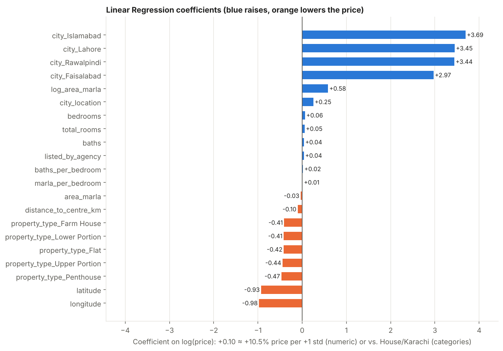

**Linear Regression.** The `log_area_marla` coefficient (+0.58 per std) is the strongest numeric effect. Flats, portions and penthouses sell for about 34% less than a house of the same size. The city coefficients look huge, but they are offset by equally large negative latitude/longitude coefficients. Karachi lies about 7° further south than the other cities, so these variables duplicate each other. This multicollinearity is one reason a linear model is hard to interpret here.

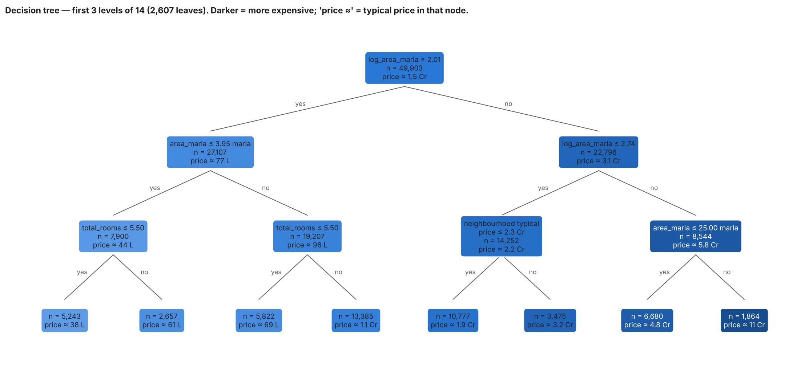

**Decision Tree.** The first two levels split on **area**, with room count and neighbourhood price level next. This is the same reasoning an estate agent uses: size first, then location.

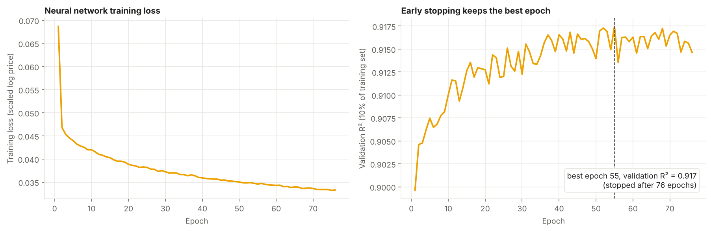

**Neural Network.** The loss falls steadily. Early stopping keeps the epoch with the best validation R², which prevents over-fitting.

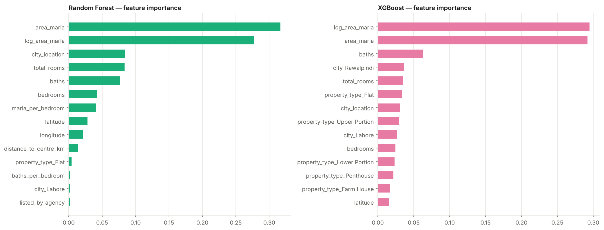

**Random Forest and XGBoost.** Area dominates both models. Next come `baths`, `city_Rawalpindi`, `total_rooms` for XGBoost, and the neighbourhood price level (`city_location`) and room counts for Random Forest.

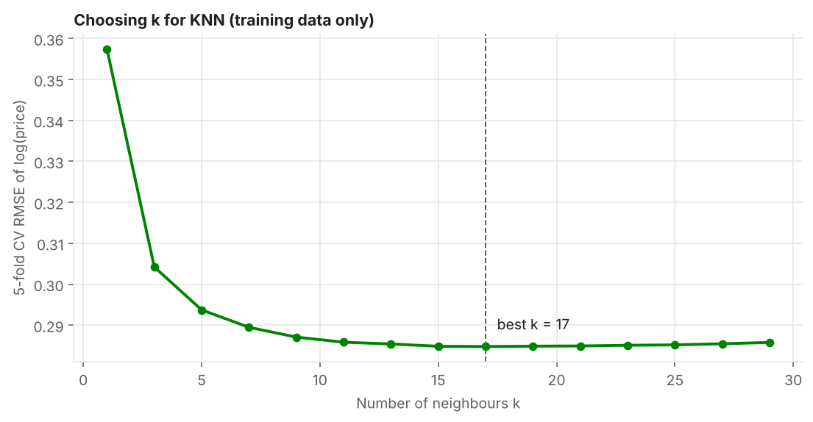

**KNN.** k = 1 memorises noise and large k over-smooths. Five-fold cross-validation picked **k = 17**.

## 6. Results

### 6.1 Comparative performance table (test set, 12,476 properties)

| Rank | Model | MAE | MSE (PKR²) | RMSE | R² | R² (log) | MAPE | Within ±10% | Within ±20% | Train time |
|---:|---|---:|---:|---:|---:|---:|---:|---:|---:|---:|
| 1 | **XGBoost** | **40.7 Lakh** | **9.844e+13** | **99.2 Lakh** | **0.9178** | 0.9380 | 18.2% | 40.2% | 68.5% | 3.1 s |
| 2 | Random Forest | 44.1 Lakh | 1.057e+14 | 1.03 Crore | 0.9117 | 0.9253 | 20.4% | 36.5% | 64.4% | 2.8 s |
| 3 | Neural Network | 46.3 Lakh | 1.144e+14 | 1.07 Crore | 0.9045 | 0.9194 | 21.5% | 34.2% | 61.8% | 23.4 s |
| 4 | Decision Tree | 48.0 Lakh | 1.387e+14 | 1.18 Crore | 0.8842 | 0.9110 | 22.1% | 35.5% | 61.7% | 0.3 s |
| 5 | KNN | 48.3 Lakh | 1.406e+14 | 1.19 Crore | 0.8826 | 0.9142 | 21.8% | 36.7% | 62.7% | 0.1 s |
| 6 | Linear Regression | 59.0 Lakh | 1.900e+14 | 1.38 Crore | 0.8413 | 0.8861 | 26.7% | 26.8% | 50.4% | 0.1 s |

XGBoost is **first on every metric**.
 The full RMSE ranking is: XGBoost > Random Forest > Neural Network > Decision Tree > KNN > Linear Regression.

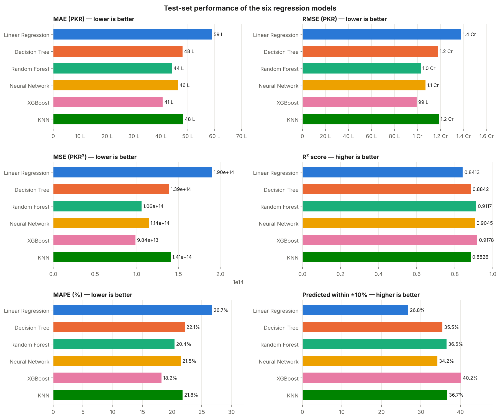

### 6.2 Actual vs predicted
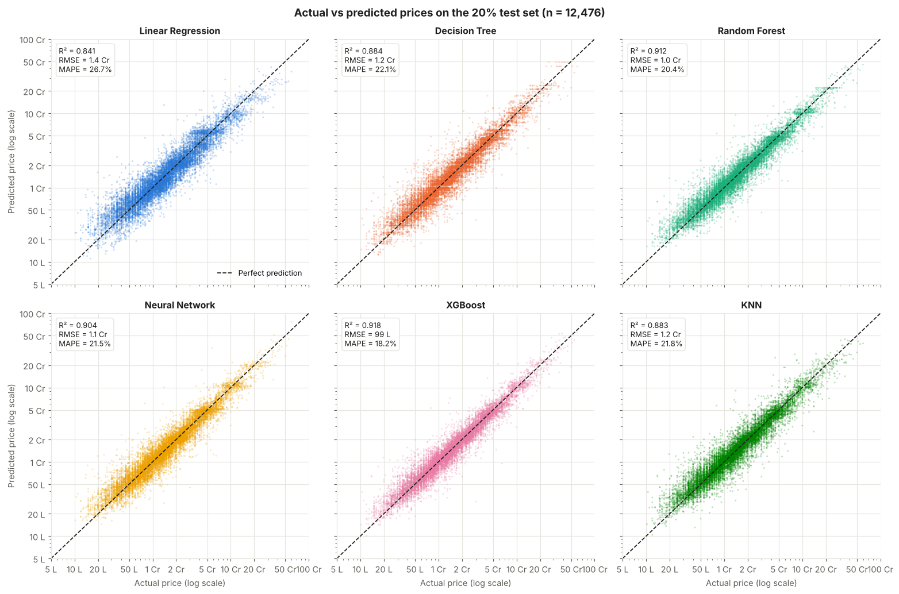

Each dot is one test property. Points on the dashed line are perfect predictions. XGBoost and Random Forest form the tightest band, and Linear Regression is the widest. Every model has more spread at the cheap end, where small flats and portions vary a lot in quality.

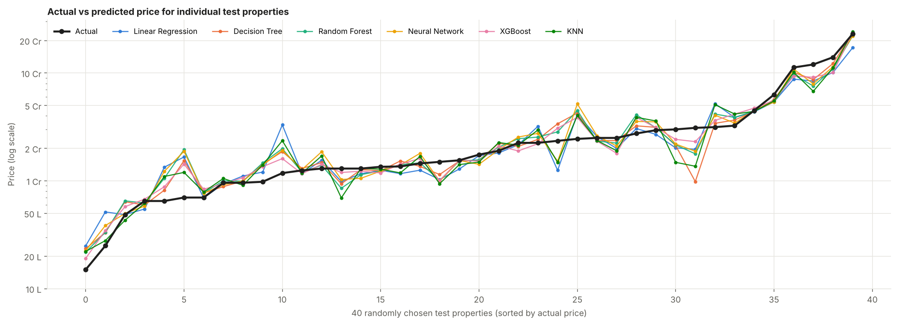

### 6.3 Over-fitting and stability
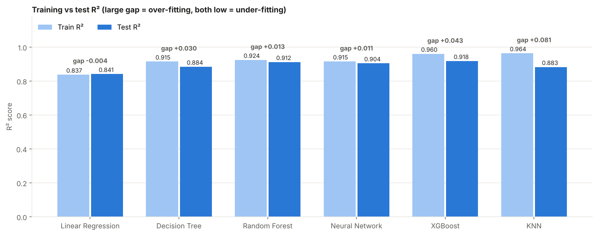

| Model | Train R² | Test R² | Gap | Diagnosis |
|---|---:|---:|---:|---|
| Linear Regression | 0.837 | 0.841 | -0.004 | No over-fitting, but under-fits: the model is too simple |
| Decision Tree | 0.915 | 0.884 | +0.030 | Mild over-fitting, limited by depth 14 and leaf size 8 |
| Random Forest | 0.924 | 0.912 | +0.013 | Small gap: averaging 80 trees keeps it stable |
| Neural Network | 0.915 | 0.904 | +0.011 | Small gap thanks to early stopping |
| XGBoost | 0.960 | 0.918 | +0.043 | Learns the training data closely, yet still has the best test score; regularisation and shrinkage keep it general |
| KNN | 0.964 | 0.883 | +0.081 | Largest gap: it stores the training set, and each training point is its own closest neighbour |

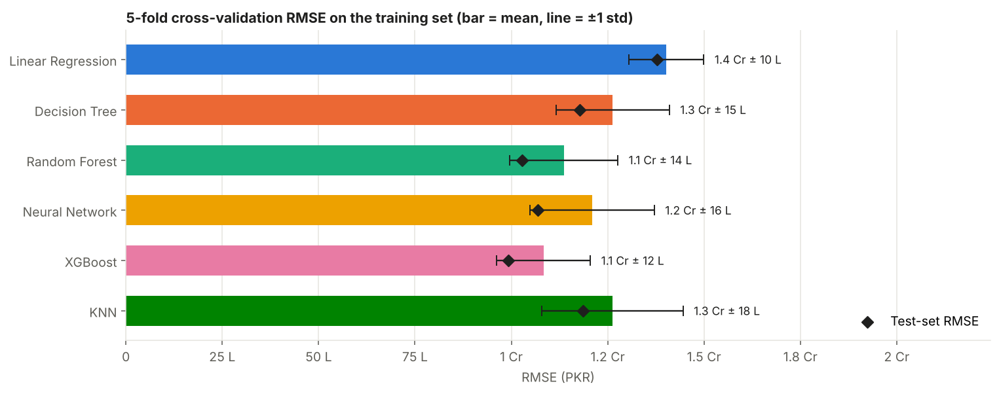

Five-fold cross-validation on the training set gives the same ranking. XGBoost has the lowest CV RMSE (1.08 Crore ± 12.1 Lakh), so the result does not depend on one lucky split.

## 7. Error analysis

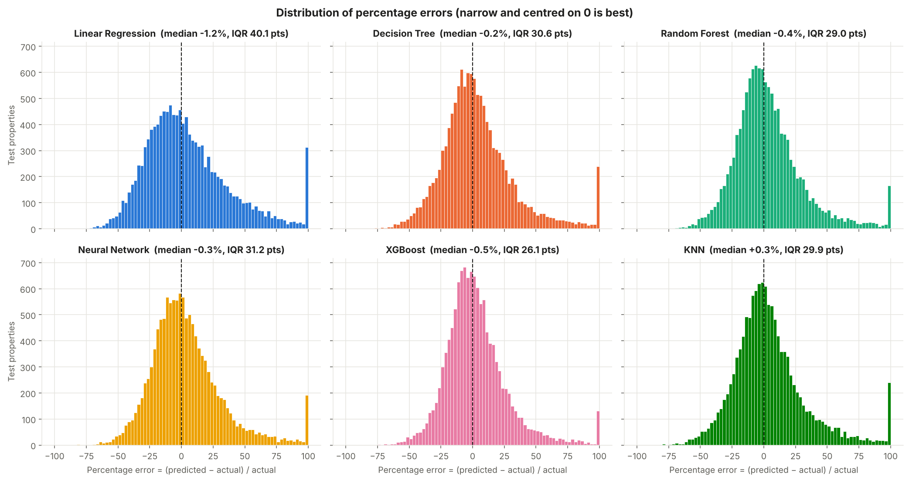

Percentage errors are centred close to 0 for every model, so none of them systematically over- or under-prices. XGBoost has the narrowest spread. The small bars at the edges collect the errors beyond ±100%.

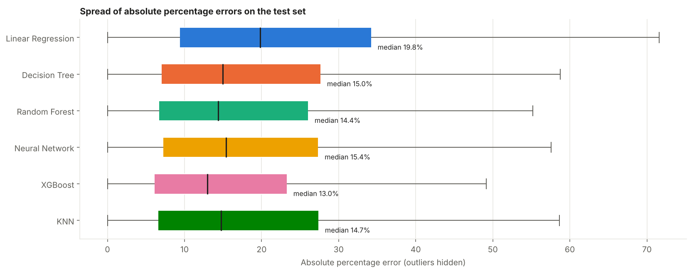

| Model | Median absolute % error | MAPE |
|---|---:|---:|
| XGBoost | 13.0% | 18.2% |
| Random Forest | 14.4% | 20.4% |
| Neural Network | 15.4% | 21.5% |
| Decision Tree | 15.0% | 22.1% |
| KNN | 14.7% | 21.8% |
| Linear Regression | 19.8% | 26.7% |

### 7.1 By price range
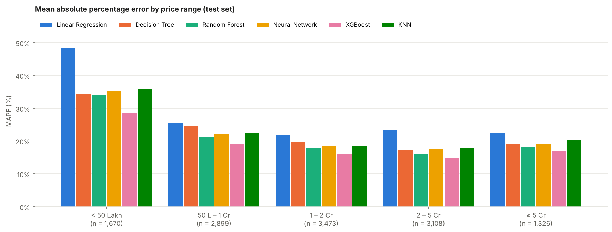

| Price range | Test rows | Linear Regression | Decision Tree | Random Forest | Neural Network | XGBoost | KNN |
|---|---:|---:|---:|---:|---:|---:|---:|
| < 50 Lakh | 1,670 | 48.5% | 34.4% | 34.0% | 35.4% | **28.6%** | 35.9% |
| 50 L – 1 Cr | 2,899 | 25.5% | 24.5% | 21.3% | 22.3% | **19.1%** | 22.5% |
| 1 – 2 Cr | 3,473 | 21.8% | 19.6% | 17.9% | 18.6% | **16.1%** | 18.4% |
| 2 – 5 Cr | 3,108 | 23.4% | 17.4% | 16.1% | 17.5% | **14.8%** | 17.9% |
| ≥ 5 Cr | 1,326 | 22.6% | 19.2% | 18.2% | 19.1% | **16.9%** | 20.3% |

Cheap properties (under 50 lakh) are the hardest in percentage terms. A 10-lakh error is small for a 5-crore house but large for a 40-lakh flat.

### 7.2 By city
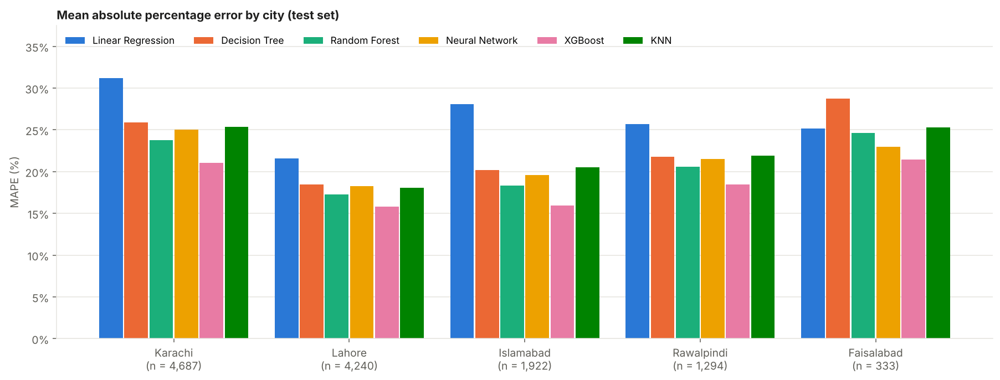

| City | Test rows | Linear Regression | Decision Tree | Random Forest | Neural Network | XGBoost | KNN |
|---|---:|---:|---:|---:|---:|---:|---:|
| Karachi | 4,687 | 31.2% | 25.9% | 23.8% | 25.0% | **21.1%** | 25.4% |
| Lahore | 4,240 | 21.6% | 18.5% | 17.3% | 18.3% | **15.8%** | 18.1% |
| Islamabad | 1,922 | 28.1% | 20.2% | 18.3% | 19.6% | **16.0%** | 20.5% |
| Rawalpindi | 1,294 | 25.7% | 21.8% | 20.6% | 21.6% | **18.5%** | 21.9% |
| Faisalabad | 333 | 25.2% | 28.7% | 24.6% | 22.9% | **21.4%** | 25.3% |

Lahore and Islamabad are the easiest cities to price: they have well-defined societies and sectors. Karachi is harder because it has many apartment blocks and large price differences inside the same neighbourhood. Faisalabad is hard because it has the fewest listings to learn from.

### 7.3 By property type
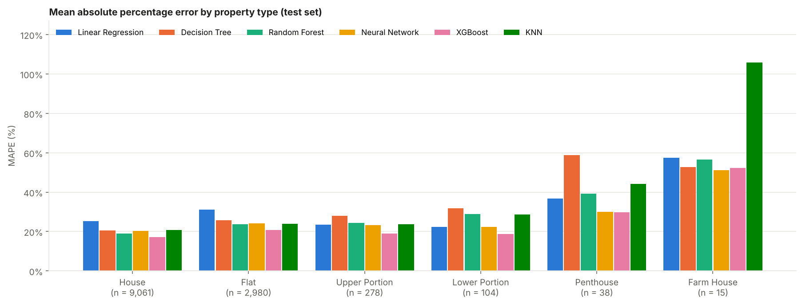

| Property type | Test rows | Linear Regression | Decision Tree | Random Forest | Neural Network | XGBoost | KNN |
|---|---:|---:|---:|---:|---:|---:|---:|
| House | 9,061 | 25.3% | 20.5% | 19.0% | 20.4% | **17.3%** | 20.7% |
| Flat | 2,980 | 31.2% | 25.6% | 23.8% | 24.2% | **20.8%** | 23.9% |
| Upper Portion | 278 | 23.5% | 27.9% | 24.3% | 23.2% | **18.9%** | 23.7% |
| Lower Portion | 104 | 22.2% | 31.9% | 28.9% | 22.3% | **18.8%** | 28.6% |
| Penthouse | 38 | 36.7% | 58.9% | 39.1% | 30.0% | **29.8%** | 44.2% |
| Farm House | 15 | 57.5% | 52.8% | 56.7% | **51.1%** | 52.4% | 106.0% |

Houses are priced best. Penthouses and farm houses are rare (fewer than 200 and 100 listings), so every model is unreliable for them. More data, not a different algorithm, would fix that.

## 8. Strengths and limitations

| Algorithm | Strengths | Limitations (observed here) |
|---|---|---|
| **Linear Regression** | Instant to train; coefficients are readable; a solid baseline thanks to log(price) and log(area) | Cannot model interactions (a marla in DHA is worth more than a marla elsewhere); multicollinearity makes coefficients misleading; worst MAPE (26.7%) |
| **Decision Tree** | Captures non-linearity; easy to explain as if/else rules; no scaling needed | Unstable (high variance); predictions are step-shaped; weaker than the ensembles |
| **Random Forest** | Averaging many trees cuts variance (RMSE 13% lower than one tree); robust; little tuning | Larger model file; cannot extrapolate beyond the prices it has seen |
| **Neural Network** | Learns smooth non-linear functions; third best | Slowest to train; needs scaling and tuning; a black box |
| **XGBoost** | Sequential trees correct earlier errors (lower bias); regularisation (λ, η, subsampling) controls variance; fast | Many hyper-parameters; large train/test gap shows it can over-fit without regularisation; less interpretable |
| **KNN** | Simple, intuitive ("similar properties sold for…"); no training | Needs scaling; slow predictions on big data; memorises the training set; struggles with rare types (farm houses) |

## 9. Best model and justification

**XGBoost is the best-performing algorithm.** The evidence:

1. **Best on all four required metrics:** MAE 40.7 Lakh, MSE 9.844e+13, RMSE 99.2 Lakh, R² 0.9178.
2. **Best in practical terms:** lowest MAPE (18.2%) and the most properties within ±10% (40.2%) and ±20% (68.5%).
3. **Stable:** lowest 5-fold CV RMSE (1.08 Crore ± 12.1 Lakh).
4. **Consistent:** lowest error in every price band, in every city and for every common property type.
5. **Practical:** trains in about 3 seconds and the saved model is about 2 MB.

**Why it wins:** a property's price depends on **interactions**. The value of a marla depends on the city, the neighbourhood, the property type and the size together. Tree-based models capture such interactions automatically. Random Forest averages independent trees and mainly **reduces variance**. XGBoost builds each new tree on the remaining errors (gradients) of the current model, so it also **reduces bias**. Its regularisation (λ, a small learning rate η, row and column subsampling) keeps the extra flexibility from turning into over-fitting. Gradient-boosted trees are usually the best choice on structured tabular data like this, and this experiment agrees.

## 10. Conclusion

All six algorithms were implemented under identical conditions on 62,379 cleaned Zameen.com listings. Tree ensembles clearly beat the single models: XGBoost (R² 0.918) ranks first, followed by Random Forest (0.912) and Neural Network (0.904). Linear Regression under-fits (0.841) because property prices are driven by interactions between size and location.

**Possible improvements:**
- Listing text such as 'corner', 'park facing' or 'brand new' (needs NLP on the title)
- More recent listings, since prices have risen sharply since 2019
- Plot and commercial listings
- Monotonic constraints, so that price never falls when area rises
- Prediction intervals (quantile regression) so the app can show a price range

## 11. Using the trained models

```bash
streamlit run app.py      # interactive web app: choose city, neighbourhood, size → price from all 6 models
python predict.py         # command line example
```

Every saved model in `models/` includes its preprocessing, so it can be loaded with `joblib.load` and given a raw property description. The app limits each input to realistic values found in the data, so it cannot be asked about impossible properties.

## 12. Reproducing the results

```bash
pip install -r requirements.txt
python train.py          # cleans the data, trains the 6 models, writes models/, results/, data/
python make_report.py    # rebuilds this report
python handwritten/hand_calculations.py   # rebuilds the handwritten solution
```

| Output | Content |
|---|---|
| `data/raw/zameen-updated.csv.xz` | Original Zameen.com dataset (all 168,446 rows, compressed; pandas reads it directly) |
| `data/zameen_clean.csv` | Cleaned dataset |
| `data/train.csv`, `data/test.csv` | The exact training and test rows with all 14 inputs and the price |
| `models/*.joblib` | The 6 trained models |
| `results/metrics.csv` | All metrics for all models |
| `results/test_predictions.csv`, `train_predictions.csv` | Actual and predicted price for every property |
| `results/mape_by_*.csv` | Error by price range, city and property type |
| `results/hyperparameter_tuning.csv` | Tuning trials |
| `results/figures/` | All figures in this report |
