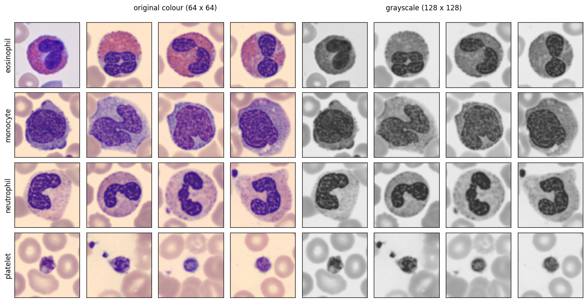
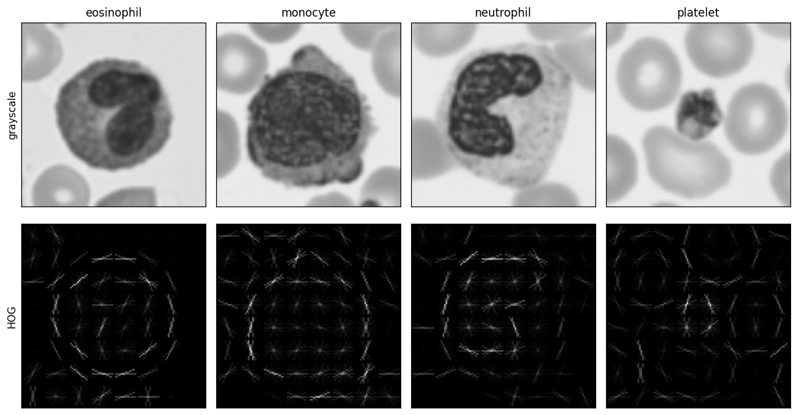
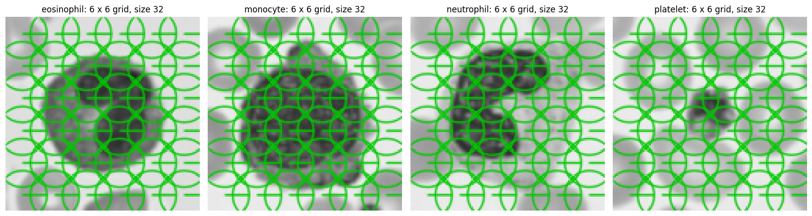
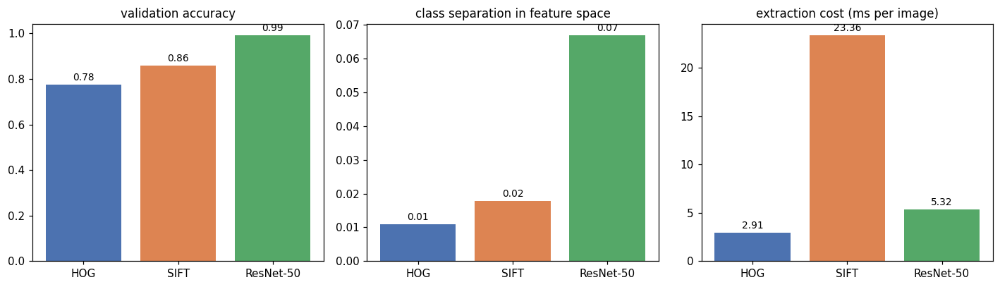
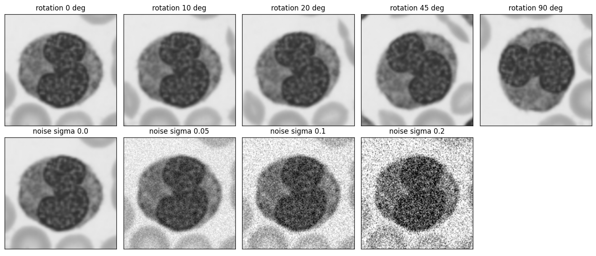
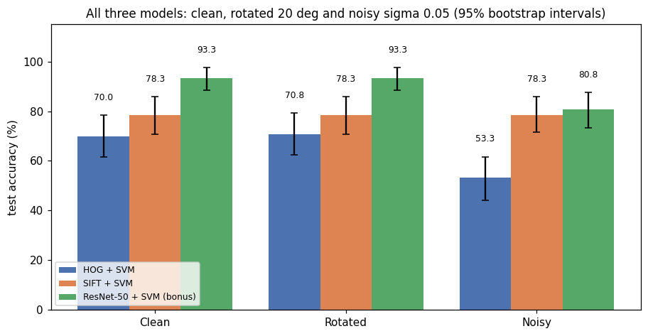
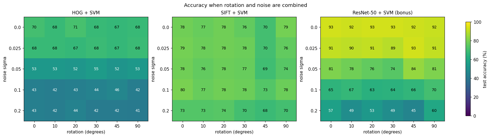
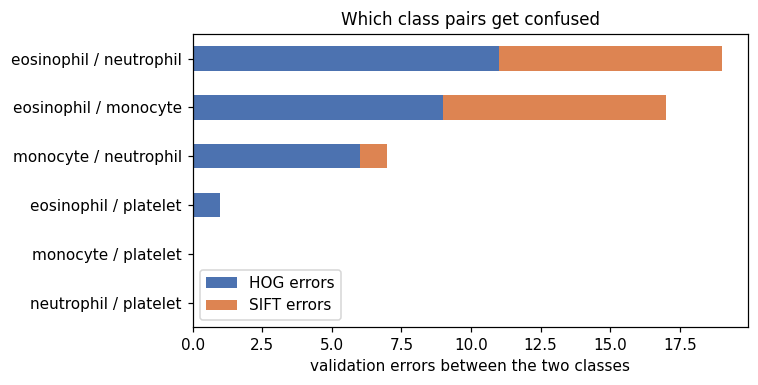
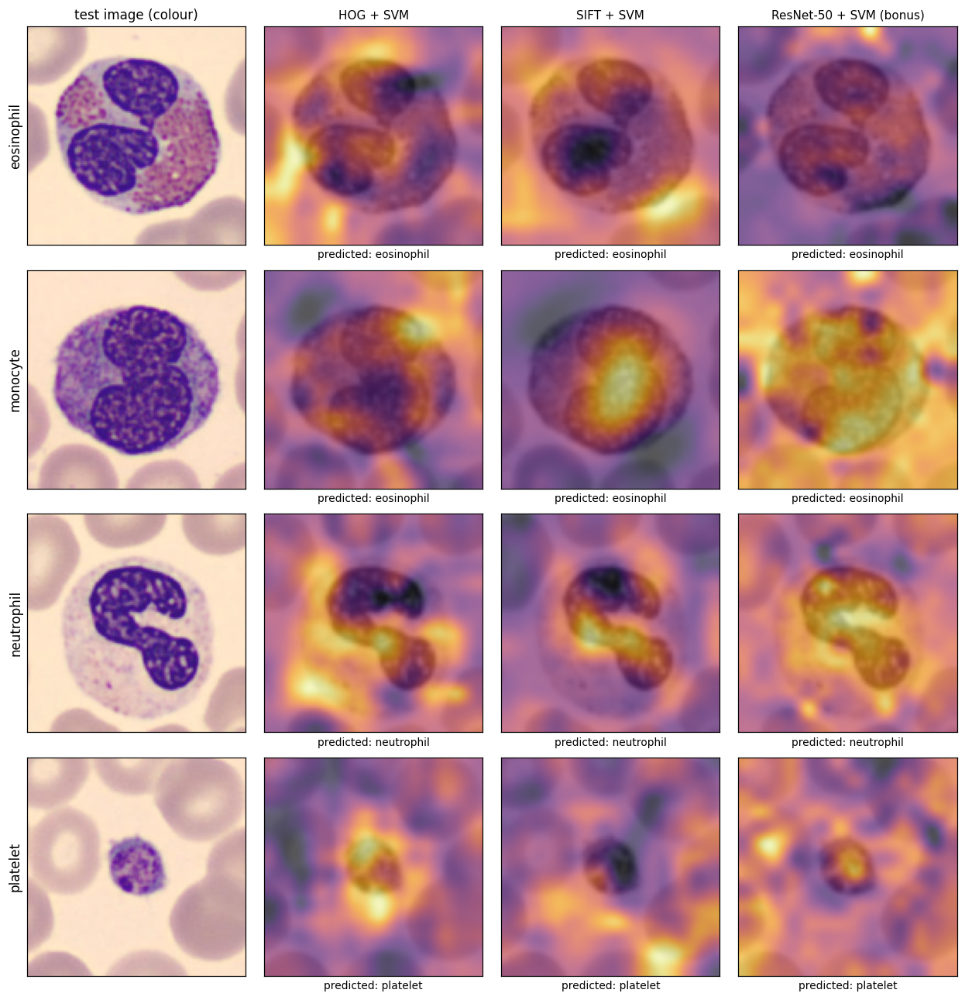

# Lab Mid Exam: HOG vs SIFT vs ResNet-50 on Blood-Cell Images

[](https://github.com/asad-mashood)
[](https://github.com/asad-mashood)
[-purple)](https://github.com/asad-mashood/computer_vi)
[](https://ww3.comsats.edu.pk/)
[-emerald)](https://medmnist.com/)
[](https://opencv.org/)
[](LICENSE)

An experimental comparative benchmark evaluating classical handcrafted feature extraction (**HOG** and **Dense SIFT**) against deep transfer learning (**ResNet-50**) for the 4-class classification of blood cells from the **BloodMNIST** benchmark.

---

## 1. Student Parameter Derivation

According to the examination protocol, all configurations are derived deterministically from registration number **FA23-BAI-039**:

| Parameter | Derivation Rule | Assigned Value |
| :--- | :--- | :---: |
| **Registration Number** | Provided ID | `FA23-BAI-039` |
| **Random Seed** | Last two digits of roll suffix (`39`) | `39` |
| **HOG Cell Size** | Last digit `9` is odd -> `16 x 16` | `16 x 16 pixels` |
| **SIFT Grid Size** | Last digit `9` is between 5 and 9 -> `6 x 6` | `6 x 6 grid (36 keypoints)` |
| **Selected Classes** | 4 Target blood cell types | `eosinophil`, `monocyte`, `neutrophil`, `platelet` |
| **Dataset Splits** | Balanced sampling across classes | `100 Train / 30 Val / 30 Test per class` |

```text
Student        : Muhammad Asad Mashood (FA23-BAI-039)
Random seed    : 39
HOG cell size  : 16 x 16
SIFT grid size : 6 x 6 (36 keypoints)
Dataset splits : 400 Train | 120 Validation | 120 Test
```

---

## 2. Dataset Overview & Sample Imagery

The dataset was subsampled from **BloodMNIST**, verified for zero cross-split data leakage via MD5 hashes, and resized to `128 x 128` pixels using bilinear interpolation.

<div align="center">
  
  <p><em>Figure 1: Representative blood cell specimens across the four target classes (RGB and Grayscale 128x128).</em></p>
</div>

---

## 3. Comparative Feature Extraction Pipelines

### Pipeline 1: HOG + Linear SVM
- **Cell Size:** `16 x 16` pixels (yielding `8 x 8 = 64` cells per 128x128 image)
- **Block Size:** `2 x 2` cells with unit step (`7 x 7 = 49` overlapping blocks)
- **Gradient Bins:** 9 unsigned orientation bins over [0 deg, 180 deg]
- **Feature Vector Length:** `49 blocks x 4 cells x 9 bins = 1,764 features`
- **Classifier:** LinearSVC tuned on validation set (`C = 0.1` selected)

<div align="center">
  
  <p><em>Figure 2: HOG gradient orientation fields computed over 16x16 pixel cells.</em></p>
</div>

### Pipeline 2: Dense SIFT + Linear SVM
- **Fixed Spatial Grid:** `6 x 6` uniform keypoint coordinates (36 keypoints)
- **Scale & Angle:** Scale frozen to `32`, orientation frozen to `0 deg`
- **Feature Vector Length:** `36 keypoints x 128 dimensions = 4,608 features`
- **Descriptor Normalization:** Divided by `512` for linear classifier scaling
- **Classifier:** LinearSVC tuned on validation set (`C = 1.0` selected)

<div align="center">
  
  <p><em>Figure 3: Dense 6x6 keypoint grid sampling resolving SIFT's variable keypoint problem.</em></p>
</div>

### Pipeline 3 (Bonus): Deep Representation (ResNet-50 + Linear SVM)
- **Backbone:** ImageNet-pretrained ResNet-50 penultimate layer (`2,048` dimensions)
- **Color Input:** Evaluated on native RGB (`99.17%` validation accuracy)
- **Grayscale Input:** Evaluated on 3-channel grayscale (`97.50%` validation accuracy)

---

## 4. Benchmark Results & Performance Telemetry

### Master Model Comparison

| Model | Representation | Dimensions | Val Accuracy | Val Macro-F1 | Clean Test | Rotated (20 deg) | Noisy (sigma=0.05) | Latency (ms/img) |
| :--- | :--- | :---: | :---: | :---: | :---: | :---: | :---: | :---: |
| **HOG + Linear SVM** | Handcrafted (16x16) | 1,764 | 77.50% | 77.56% | 70.00% | 70.83% | 53.33% | **2.91 ms** |
| **Dense SIFT + SVM** | Handcrafted (6x6 Grid) | 4,608 | 85.83% | 85.60% | 78.33% | 78.33% | 78.33% | 23.36 ms |
| **ResNet-50 + SVM (Gray)** | Deep Pretrained | 2,048 | 97.50% | 97.48% | 90.83% | 90.83% | 77.50% | 5.32 ms |
| **ResNet-50 + SVM (Color)** | Deep Pretrained | 2,048 | **99.17%** | **99.17%** | **93.33%** | **93.33%** | **80.83%** | 5.32 ms |

<div align="center">
  
  <p><em>Figure 4: Multi-metric comparison showing validation accuracy, Macro-F1, silhouette score, and extraction speed.</em></p>
</div>

---

## 5. Robustness & Perturbation Stress-Testing

Frozen models were evaluated against controlled perturbations on the 120-image held-out test set:
- **Clean Test:** Baseline test images
- **In-Plane Rotation:** 20 degree counterclockwise rotation (`cv2.BORDER_REFLECT`)
- **Additive Gaussian Noise:** Gaussian noise with `sigma = 0.05` on `[0, 1]` scale

<div align="center">
  
  <p><em>Figure 5: Visual impact of 20 degree rotation and Gaussian noise (sigma = 0.05) on blood cell test samples.</em></p>
</div>

### Paired Bootstrap Hypothesis Testing (B = 5,000 resamples)
- **Rotation:** `HOG +0.83%` vs `SIFT 0.00%`. Neither model suffered significant degradation: `P(HOG loses more) = 0.412`.
- **Gaussian Noise:** `HOG -16.67%` (collapsing from 70.00% to 53.33%) vs `SIFT 0.00%` (remaining perfectly steady at 78.33%).
- **Statistical Significance:** `P(HOG loses more under noise) = 0.998 (p < 0.002)`. HOG's block contrast normalization severely amplifies noise gradients in flat background regions, whereas SIFT pre-smooths gradients with a Gaussian scale space.

<div align="center">
  
  <p><em>Figure 6: Accuracy drop profiles across clean, rotated, and noisy test conditions.</em></p>
</div>

### 2D Rotation vs Noise Grid Sweeps

<div align="center">
  
  <p><em>Figure 7: 2D accuracy response heatmaps across 6 rotation angles and 5 noise levels for HOG, SIFT, and ResNet-50.</em></p>
</div>

---

## 6. Error Analysis & Biological Insight

### Most Confused Class Pair: Eosinophil vs Neutrophil
Across both handcrafted models, the dominant source of error on the validation split was the confusion between **eosinophils and neutrophils** (19 total validation errors):

| Confused Class Pair | HOG Errors | SIFT Errors | Joint Errors |
| :--- | :---: | :---: | :---: |
| **eosinophil / neutrophil** | **11** | **8** | **19** |
| eosinophil / monocyte | 9 | 8 | 17 |
| monocyte / neutrophil | 6 | 1 | 7 |
| eosinophil / platelet | 1 | 0 | 1 |
| monocyte / platelet | 0 | 0 | 0 |
| neutrophil / platelet | 0 | 0 | 0 |

**Biological Explanation:** Both cells are polymorphonuclear granulocytes with similar size (12-15 microns) and lobed nuclei. Cytologists distinguish them primarily by granule staining color: eosinophil granules stain bright orange-red, while neutrophil granules stain pale pinkish-lilac. Grayscale conversion collapses this chromatic distinction:
- **Grayscale Separation:** `Cohen's d = 0.939`
- **Green Channel Separation:** `Cohen's d = 1.058` (highest class divergence)

<div align="center">
  
  <p><em>Figure 8: Validation error frequency by class pair across handcrafted models.</em></p>
</div>

---

## 7. Model Explainability: Occlusion Sensitivity Maps

Using a sliding `16 x 16` occlusion patch with stride `8`, prediction drops were measured to visualize where each vision model focuses its spatial attention:
- **HOG:** Focuses primarily on outer cell boundaries and cytoplasmic edge transitions.
- **Dense SIFT:** Attends to internal nuclear texture variations and chromatin patches.
- **ResNet-50:** Holistically integrates cytoplasmic granularity and nuclear lobation geometry.

<div align="center">
  
  <p><em>Figure 9: Occlusion sensitivity heatmaps revealing the discriminative spatial regions attended by each model.</em></p>
</div>

---

## 8. Interactive Browser Dashboard

An interactive browser dashboard is included in [`dashboard.html`](dashboard.html) and [`docs/index.html`](docs/index.html):
- Real-time rotation and Gaussian noise injection sliders on test specimens.
- Live model confidence gauge comparisons across HOG, SIFT, and ResNet-50.
- Embedded telemetry charts and confusion matrices.

```bash
# Launch dashboard locally
python -m http.server 8000 --directory LAB_MID
# Open http://localhost:8000/dashboard.html in your browser
```

---

## 9. File Structure

```
LAB_MID/
├── figures/                                    # 28 High-resolution benchmark figures
├── tables/                                     # Raw CSV performance telemetry and sweep grids
├── docs/index.html                             # GitHub Pages web deployment
├── dashboard.html                              # Standalone interactive inspection studio
├── FA23_BAI_039_Muhammad_Asad_Mashood_LabMid(cv).ipynb # Executed Colab notebook with outputs
├── requirements.txt                            # Pinned Python package dependencies
└── README.md                                   # This comprehensive report
```

---

## 👤 Author & Academic Attribution

- **Student:** Muhammad Asad Mashood ([@asad-mashood](https://github.com/asad-mashood))
- **Student ID:** FA23-BAI-039
- **Course:** CSC455 - Computer Vision Laboratory
- **Institution:** COMSATS University Islamabad, Wah Campus
- **Repository:** [computer_vi](https://github.com/asad-mashood/computer_vi)
