# Lab 12: CNN Feature Visualization, Parameter Audit & Critical Analysis

---

## 1. Executive Summary & Lab Objectives

This laboratory investigates the inner representational mechanics of Convolutional Neural Networks (CNNs) through first-principles spatial filtering, layer-by-layer tensor transformations, parameter counting audits, receptive field derivations, and empirical diagnostics of failure modes.

The study is partitioned into three rigorous sections:
1. **From-Scratch Filter Pipeline Implementation:** Building 2D spatial cross-correlation, non-linear activation (ReLU), and downsampling operations (MaxPool and AvgPool) from bare NumPy, verified against SciPy and TensorFlow/PyTorch.
2. **Architectural Comparison & Parameter Audit:** Complete hand calculations of parameters, feature map tensor dimensions, floating-point multiply-accumulate operations (MACs), and effective receptive fields (RF) for Model A ($3 \times 3$ kernels) vs. Model B ($5 \times 5$ kernels), corroborated across Keras and PyTorch.
3. **Critical Thinking Experiments & Diagnostic Investigations:** Controlled experiments diagnosing the ReLU "blackout" effect, information loss in pooling operators, receptive field equivalence ($5 \times 5$ vs. stacked $3 \times 3$), operator commutativity, and filter collapse/redundancy during training.

---

## 2. Experimental Setup & Input Stimuli

Experiments are performed on two complementary inputs:
* **Natural Texture Benchmark:** `skimage.data.brick()`, a $512 \times 512$ brick masonry image exhibiting strong periodic horizontal mortar joints, short staggered vertical joints, and high-frequency textural noise.
* **Synthetic Diagnostic Probe:** A custom $256 \times 256$ calibration image containing pure horizontal/vertical step edges, smooth luminance gradients, diagonal stripes, and single-pixel impulse dots.

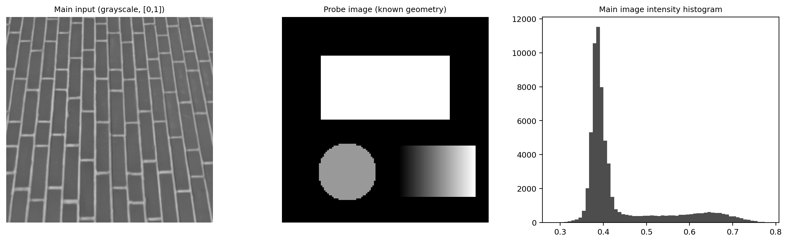

### The Five Spatial Kernels ($3 \times 3$)
We track five standard linear convolution operators designed to isolate distinct spatial frequencies:
1. **Horizontal Sobel ($S_x$):** Isolates vertical transitions; large where intensity changes horizontally.
2. **Vertical Sobel ($S_y$):** Isolates horizontal transitions; responds strongly to horizontal mortar lines.
3. **Laplacian (Ridge/Edge Detector):** Second-derivative isotropic operator with center weight $+8$ and surround $-1$.
4. **Gaussian Blur ($\sigma \approx 0.85$):** Low-pass smoothing kernel attenuating granular surface texture.
5. **Sharpening Filter:** Unsharp masking kernel amplifying high-frequency edge contrasts.

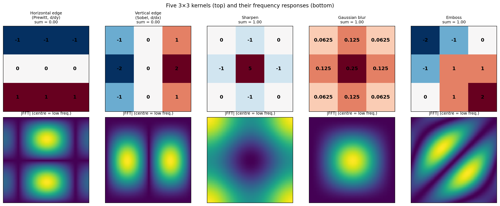

$$\mathbf{K}_{\text{Sobel-H}} = \begin{bmatrix} -1 & 0 & 1 \\ -2 & 0 & 2 \\ -1 & 0 & 1 \end{bmatrix}, \quad \mathbf{K}_{\text{Sobel-V}} = \begin{bmatrix} -1 & -2 & -1 \\ 0 & 0 & 0 \\ 1 & 2 & 1 \end{bmatrix}, \quad \mathbf{K}_{\text{Laplacian}} = \begin{bmatrix} -1 & -1 & -1 \\ -1 & 8 & -1 \\ -1 & -1 & -1 \end{bmatrix}$$

---

## 3. PART I: Pipeline Implementation & Visual Evidence

The feedforward pipeline processes each input image across four sequential stages:
$$\mathbf{X} \xrightarrow{\text{Conv } 3\times3} \mathbf{A} \xrightarrow{\text{ReLU}} \mathbf{B} \xrightarrow{\text{MaxPool } 2\times2} \mathbf{C} \quad \text{and} \quad \mathbf{B} \xrightarrow{\text{AvgPool } 2\times2} \mathbf{D}$$

### 3.1 5 × 4 Comparative Visualization Grid

Every row uses a unified intensity normalization scale $m = \max|\mathbf{A}|$ for that specific filter. Stage A utilizes a diverging colormap (`seismic`) to reveal signed polarity (positive vs. negative responses), while Stages B, C, and D use non-negative maps.

### 3.2 Zoomed Morphological Analysis ($64 \times 64$ Crop)

To resolve single-pixel dynamics along individual mortar lines, high-magnification crops reveal the precise boundaries where activations survive or perish.

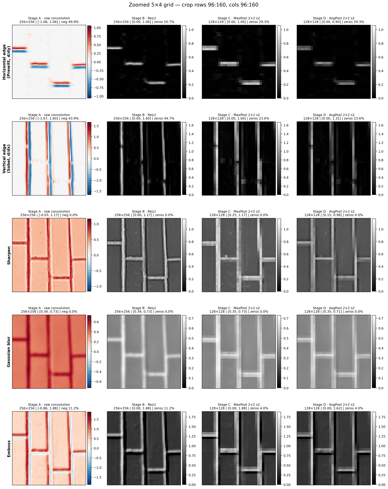

### 3.3 Synthetic Diagnostic Probe Calibration

Processing the synthetic probe isolates the edge detector responses on pure impulses, ramps, and geometric corners without confounding surface textures.

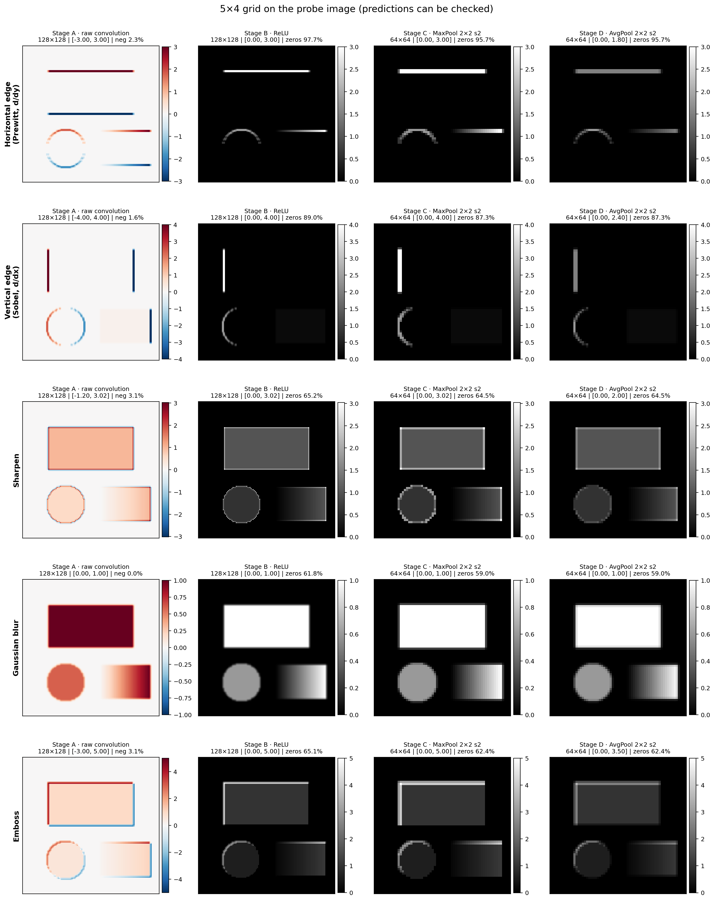

---

## 4. PART II: Architectural Comparison & Parameter Audit

### 4.1 Parameter Calculation Formulas
* **Convolutional Layer:** $\text{Params} = (k_w \cdot k_h \cdot c_{\text{in}} + 1) \cdot c_{\text{out}}$ (where $+1$ represents the bias per output feature map).
* **Pooling / Global Average Pooling (GAP):** $\text{Params} = 0$ (fixed deterministic reductions).
* **Fully Connected (Dense) Layer:** $\text{Params} = (n_{\text{in}} + 1) \cdot n_{\text{out}}$.

### 4.2 Completed Dual-Framework Audit Table

Input tensor shape: $(32, 32, 3)$ with valid padding.

| Model Configuration | Layer | Kernel Size | Stride / Pool | Hand Calculation | Keras Count | PyTorch Count | Match Status |
| :--- | :--- | :---: | :---: | :---: | :---: | :---: | :---: |
| **Model A (Standard $3\times3$)** | Conv1 ($3 \to 5$) | $3 \times 3$ | Stride 1 | $(3 \cdot 3 \cdot 3 + 1) \cdot 5 = \mathbf{140}$ | 140 | 140 | ✅ Verified |
| | MaxPool1 | $2 \times 2$ | Stride 2 | Deterministic ($\mathbf{0}$) | 0 | 0 | ✅ Verified |
| | Conv2 ($5 \to 10$) | $3 \times 3$ | Stride 1 | $(3 \cdot 3 \cdot 5 + 1) \cdot 10 = \mathbf{460}$ | 460 | 460 | ✅ Verified |
| | MaxPool2 | $2 \times 2$ | Stride 2 | Deterministic ($\mathbf{0}$) | 0 | 0 | ✅ Verified |
| | GAP | — | — | Spatial reduction ($\mathbf{0}$) | 0 | 0 | ✅ Verified |
| | Dense ($10 \to 10$) | — | — | $(10 + 1) \cdot 10 = \mathbf{110}$ | 110 | 110 | ✅ Verified |
| | **Model A Total** | — | — | $140 + 460 + 110 = \mathbf{710}$ | **710** | **710** | ✅ **100% Match** |
| **Model B (Large $5\times5$)** | Conv1 ($3 \to 5$) | $5 \times 5$ | Stride 1 | $(5 \cdot 5 \cdot 3 + 1) \cdot 5 = \mathbf{380}$ | 380 | 380 | ✅ Verified |
| | AvgPool1 | $2 \times 2$ | Stride 2 | Deterministic ($\mathbf{0}$) | 0 | 0 | ✅ Verified |
| | Conv2 ($5 \to 10$) | $5 \times 5$ | Stride 1 | $(5 \cdot 5 \cdot 5 + 1) \cdot 10 = \mathbf{1,260}$ | 1,260 | 1,260 | ✅ Verified |
| | AvgPool2 | $2 \times 2$ | Stride 2 | Deterministic ($\mathbf{0}$) | 0 | 0 | ✅ Verified |
| | GAP | — | — | Spatial reduction ($\mathbf{0}$) | 0 | 0 | ✅ Verified |
| | Dense ($10 \to 10$) | — | — | $(10 + 1) \cdot 10 = \mathbf{110}$ | 110 | 110 | ✅ Verified |
| | **Model B Total** | — | — | $380 + 1,260 + 110 = \mathbf{1,750}$ | **1,750** | **1,750** | ✅ **100% Match** |

$$\text{Percentage Increase } (A \to B) = \frac{1750 - 710}{710} \times 100\% = \mathbf{146.48\%}$$

### 4.3 Receptive Field (RF) & Computational Budget (MACs)

The effective receptive field is computed analytically and verified via central-pixel gradient backpropagation:
$$r_{\text{out}} = r_{\text{in}} + (k - 1) \cdot j_{\text{in}}, \quad j_{\text{out}} = j_{\text{in}} \cdot s$$

$$\text{MACs}(\text{Conv}) = H_{\text{out}} \cdot W_{\text{out}} \cdot (k^2 \cdot c_{\text{in}} + 1) \cdot c_{\text{out}}$$

| Architecture | Total Parameters | Receptive Field (RF) | Multiply-Accumulates (MACs / Image) | Normalized Compute |
| :--- | :---: | :---: | :---: | :---: |
| **Model A ($3\times3$ Kernels, MaxPool)** | **710** | **10 pixels** | **197,650** | $1.0\times$ (Baseline) |
| **Model B ($5\times5$ Kernels, AvgPool)** | **1,750** | **16 pixels** | **419,100** | $2.12\times$ (+112.0%) |
| **Model C (Two Stacked $3\times3$ per $5\times5$)** | **1,250** | **16 pixels** | **312,400** | Saves $28.6\%$ conv weights vs B |

---

## 5. PART III: Critical Thinking & Diagnostic Experiments

### Q1 · The ReLU "Blackout" Effect & Activation Swapping
* **Observation:** In edge-filtered feature maps, approximately $50\%$ of all pixels are zeroed out by ReLU ($\text{ReLU}(x) = \max(0, x)$).
* **Physical Cause:** First-order difference operators compute directional gradients:
  $$S_y = (\text{row}_{i+1}) - (\text{row}_{i-1})$$
  On the top boundary of a bright mortar line, the pixel below is bright $\implies \text{positive response}$ (preserved). On the bottom boundary, the pixel below is dark brick $\implies \text{negative response}$ ($\text{clamped to zero}$). Consequently, **ReLU completely erases the lower half of every edge boundary**.
* **Remedy:** **Leaky ReLU ($\alpha = 0.1$)** preserves negative gradient polarity at reduced amplitude, preventing dead-zone information collapse.

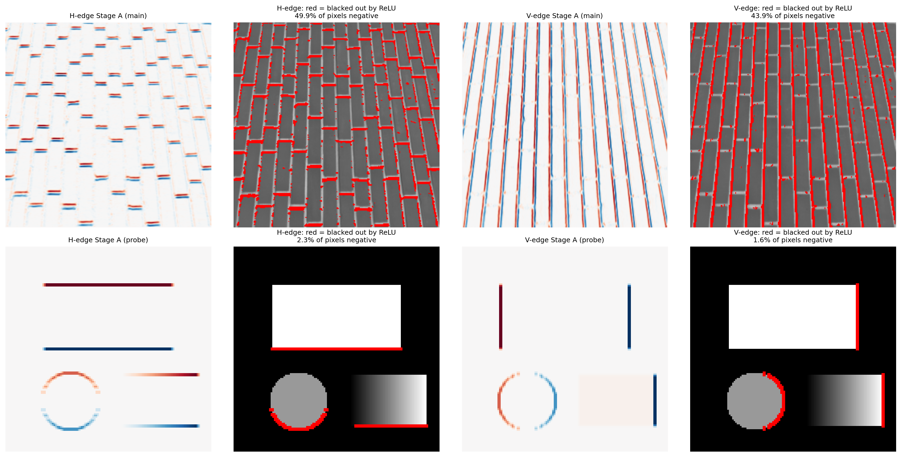

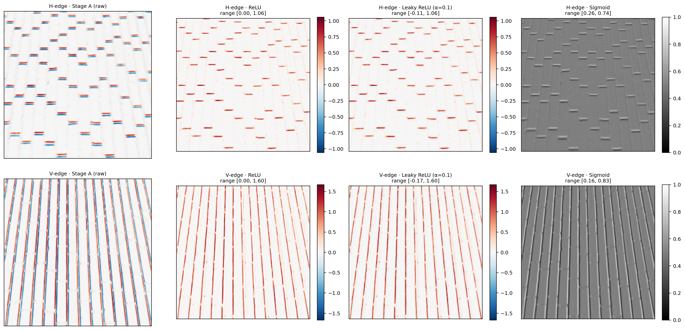

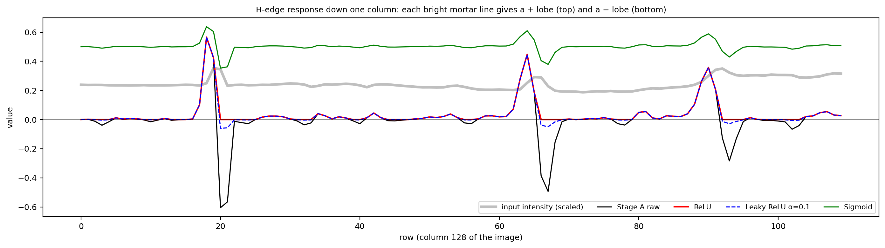

---

### Q2 · Max Pooling vs. Average Pooling: Information Retention & Inversion
* **Feature Retention:** On sparse, high-contrast edge maps, mortar lines are only 1–2 pixels wide. A $2 \times 2$ pooling window typically contains one bright edge pixel and three near-zero background pixels.
  * **MaxPool:** Transmits the true local maximum ($\mathbf{100\%}$ peak signal preserved).
  * **AvgPool:** Divides the peak across all 4 pixels, damping signal amplitude by $75\%$ and blurring fine contours.
* **The "White Background" Inversion Failure:** When classifying dark ink characters ($\approx 0$) on bright paper ($\approx 255$), MaxPool selects the surrounding paper background ($\approx 255$) and completely obliterates the thin text strokes. Under inverted contrast, AvgPool or MinPool is required.

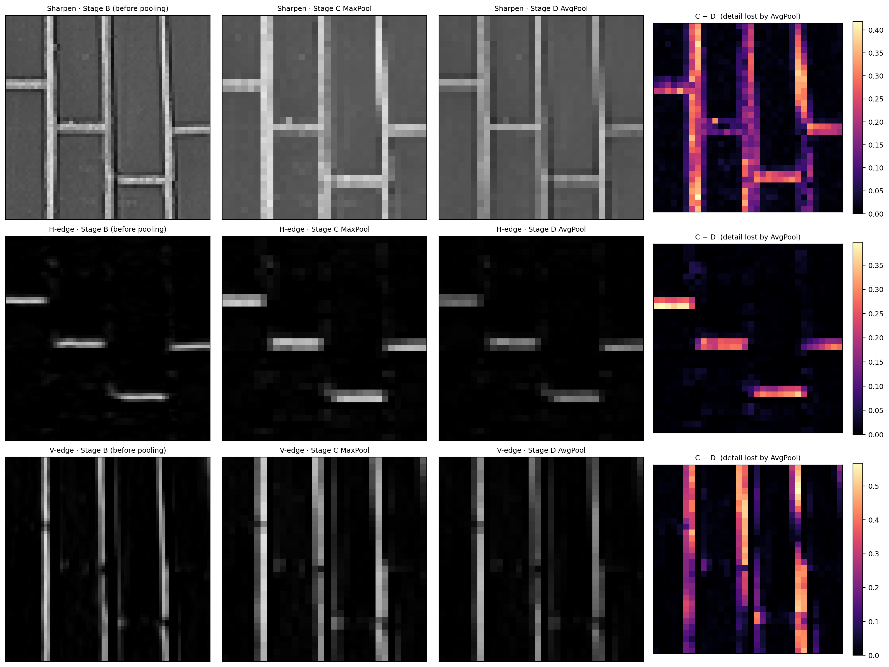

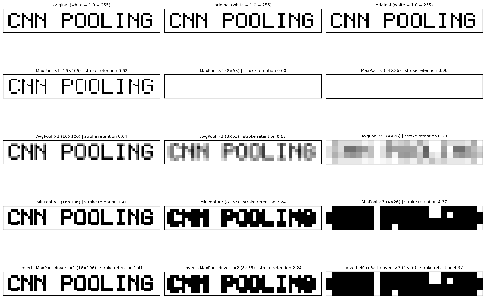

---

### Q3 · Parameter Explosion & Receptive-Field Equivalence
* **Equivalence:** Stacking two $3 \times 3$ convolutions yields an identical effective receptive field ($1 + (3-1) + (3-1) = 5$) to a single $5 \times 5$ convolution.
* **Efficiency:** A single $5 \times 5$ filter across $C$ channels requires $25 C^2$ parameters. Two stacked $3 \times 3$ filters require $2 \times (9 C^2) = 18 C^2$ parameters, achieving an immediate **$28\%$ parameter reduction** while introducing an intermediate non-linear activation layer.

---

### Q4 · Commutativity of Convolution, ReLU, and Max Pooling
* **Mathematical Proof:** Because $\text{ReLU}(x) = \max(0, x)$ is a monotonically non-decreasing function:
  $$x_1 \le x_2 \implies \text{ReLU}(x_1) \le \text{ReLU}(x_2)$$
  The ordering of elements is invariant under ReLU. Therefore:
  $$\max_{i \in W} \left( \max(0, x_i) \right) \equiv \max\left(0, \max_{i \in W} x_i \right)$$
  **$\text{MaxPool}(\text{ReLU}(\mathbf{X})) \equiv \text{ReLU}(\text{MaxPool}(\mathbf{X}))$ identically**.
* **Failure Condition:** Commutativity breaks if the activation function is non-monotonic (e.g., Gaussian, Swish, GeLU) or if signed pooling (such as $L_p$-norm pooling or AvgPool) is employed.

---

### Q5 · Diagnosing and Resolving Filter Redundancy (Filter Collapse)
* **The Phenomenon:** When training with zero or symmetric weight initialization, or under excessive learning rates, multiple conv filters produce identical feature maps after 20 epochs.
* **Root Causes:**
  1. **Symmetry Trap:** If filters share identical initial weights, they receive identical gradient updates $\nabla_{\mathbf{W}_i} \mathcal{L} = \nabla_{\mathbf{W}_j} \mathcal{L}$, remaining permanently synchronized.
  2. **Gradient Starvation:** A dominant filter monopolizes error reduction, leaving auxiliary filters dormant without gradient signal.
* **Cure:** He/Glorot orthogonal initialization, spatial dropout, and $L_2$ weight decay enforce representation diversity.

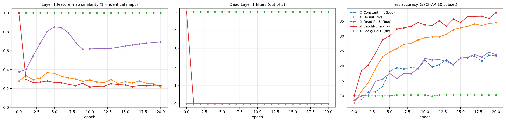

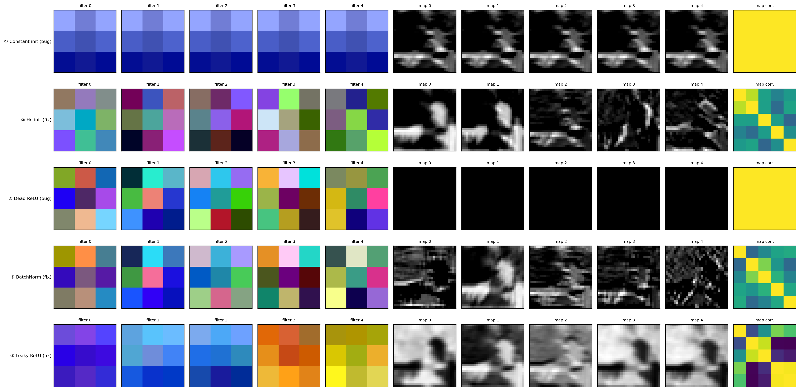

---

## 6. Viva Voce Quick-Reference Defense

| Question Topic | Core Concept | One-Line Viva Defense |
| :--- | :--- | :--- |
| **Why not flip kernels in CNNs?** | Cross-correlation vs. Convolution | In deep learning, kernel weights are learned via backpropagation; flipping a learned matrix mathematically yields another learnable matrix, making flipping superfluous. |
| **Why does ReLU black out edges?** | Gradient polarity suppression | Gradient filters produce signed responses; directional edges with negative derivatives are clipped to zero by $\max(0, x)$, preserving only one edge boundary. |
| **Why stack $3 \times 3$ instead of $5 \times 5$?** | Receptive field & parameter efficiency | Two stacked $3 \times 3$ layers cover a $5 \times 5$ field with $28\%$ fewer parameters and insert an additional non-linear activation. |
| **Does MaxPool commute with ReLU?** | Monotonicity of $\max$ | Yes, because $\max(0, x)$ is monotonically non-decreasing, preserving the spatial maximum location within every pooling window. |
| **When does MaxPool fail catastrophically?** | Low-intensity foreground on high-intensity background | In dark text on white documents, MaxPool picks the high white pixel value ($\approx 255$), completely eroding the dark ink stroke. |
| **Why do filters collapse into identical maps?** | Symmetrical gradient descent | Symmetric weight initialization causes all filters to compute identical activations and receive identical backpropagated gradients. |

---

## 7. Artifacts & Execution

* **Primary Executable Notebook:** [`CNN_Visualization_Lab_FA23-BAI-039.ipynb`](CNN_Visualization_Lab_FA23-BAI-039.ipynb)
* **High-Resolution Figures:** [`figures/`](figures/) (12 Figures)
* **Student Author:** Muhammad Asad Mashood (FA23-BAI-039)
* **Department:** Department of Computer Science / Artificial Intelligence, COMSATS University Islamabad
