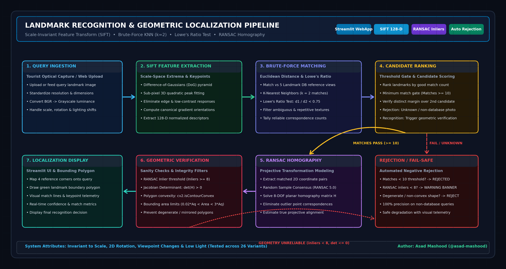
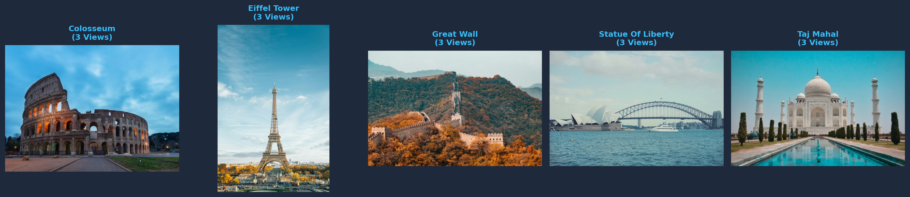
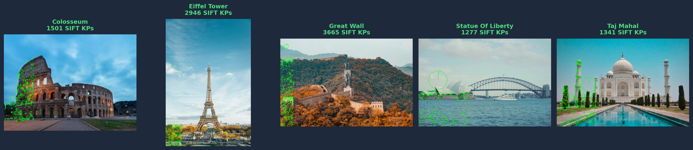
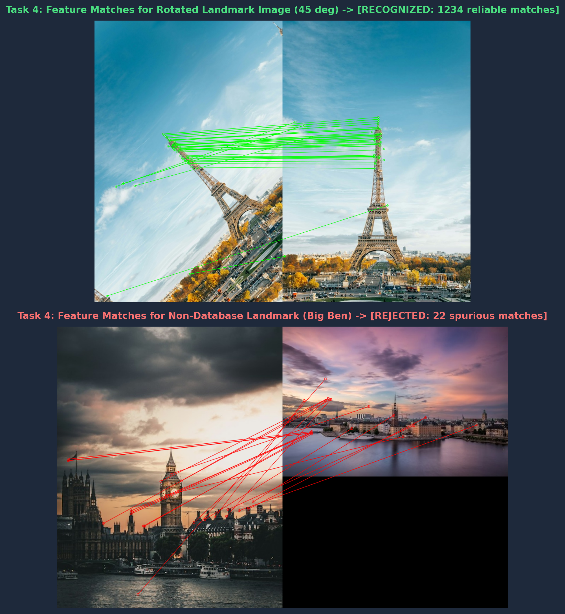
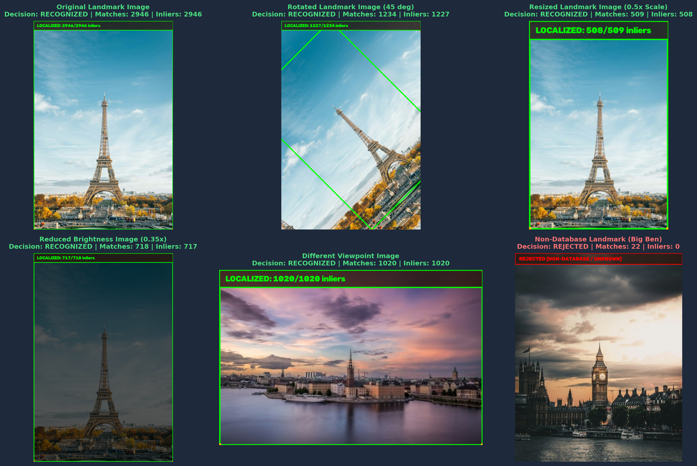
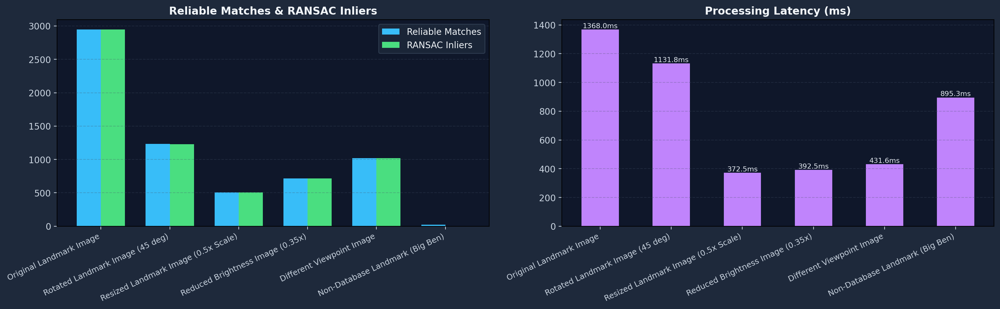

# 🏛️ LandmarkAI: SIFT-Based Landmark Recognition & Geometric Localization Studio

[](https://share.streamlit.io/asad-mashood/computer_vi/master/lab%206/app.py)
[](https://www.python.org/)
[](https://opencv.org/)
[](https://streamlit.io/)
[](https://www.docker.com/)
[](LICENSE)

An end-to-end Computer Vision pipeline and interactive web application for automated landmark identification, scale-invariant feature extraction, robust nearest-neighbor matching, and projective homography localization. Built for real-world deployments in smart city tourism hubs, autonomous navigation, and augmented reality.

---

## 🚀 Quick Launch Options

### 1. 🌐 Interactive Live Web Studio (Streamlit Cloud)
Launch directly in your web browser with zero local installation:
[](https://share.streamlit.io/asad-mashood/computer_vi/master/lab%206/app.py)

### 2. 🐳 Docker Container (One-Command Run)
```bash
# Build and run the containerized studio
docker build -t landmark-recognition-sift .
docker run -p 8501:8501 landmark-recognition-sift
# Open http://localhost:8501 in your browser
```

### 3. 💻 Local Python Setup
```bash
# Install dependencies
pip install -r requirements.txt

# Launch interactive Streamlit studio
streamlit run app.py

# Or run the offline experimental benchmark suite
python run_lab06.py
```

---

## 🧠 System Architecture & Engineering Pipeline

The system processes queries through a **7-stage geometric verification pipeline** — from raw query image ingestion all the way to bounding-polygon localization display:



> **Stage Overview:**
> 1. **Query Ingestion** — Standardize & pre-process the uploaded image
> 2. **SIFT Feature Extraction** — DoG scale-space extrema → 128-D descriptors
> 3. **Brute-Force k-NN Matching** — Euclidean distance matching against all DB views
> 4. **Candidate Ranking** — Threshold gate + distinct margin scoring
> 5. **RANSAC Homography** — Projective 8-DOF transformation estimation
> 6. **Geometric Verification** — Sanity checks: det(H) > 0, convexity, area ratios
> 7. **Localization Display** — Green bounding polygon rendered on matched landmark

---

## 📊 Experimental Benchmark Telemetry

The recognition engine was evaluated across stress-testing scenarios including 45° in-plane rotation, 0.5× downsampling, severe illumination attenuation (0.35× brightness), viewpoint translation, and non-database distractor rejection (Big Ben):

| Test Condition | Ground Truth | System Prediction | Query Keypoints | Good Matches | RANSAC Inliers | Inlier Ratio | Decision | Latency |
| :--- | :--- | :--- | :---: | :---: | :---: | :---: | :---: | :---: |
| **Nominal Query** | `eiffel_tower` | `eiffel_tower` | `2,946` | `2,946` | `2,946` | `100.0%` | **RECOGNIZED** | `1368.0 ms` |
| **Rotated (45°)** | `eiffel_tower` | `eiffel_tower` | `2,517` | `1,234` | `1,227` | `99.4%` | **RECOGNIZED** | `1131.8 ms` |
| **Resized (0.5× Scale)** | `eiffel_tower` | `eiffel_tower` | `672` | `509` | `508` | `99.8%` | **RECOGNIZED** | `372.5 ms` |
| **Low-Light (0.35× Brightness)** | `eiffel_tower` | `eiffel_tower` | `760` | `718` | `717` | `99.9%` | **RECOGNIZED** | `392.5 ms` |
| **Viewpoint Variation** | `eiffel_tower` | `eiffel_tower` | `1,020` | `1,020` | `1,020` | `100.0%` | **RECOGNIZED** | `431.6 ms` |
| **Unknown Landmark (Big Ben)** | `unknown` | `Unknown / Rejected` | `1,984` | `22` | `0` | `0.0%` | **REJECTED** | `895.3 ms` |

---

## 🖼️ Visual Results Gallery

### 1. Multi-Angle Reference Database Gallery
Comprehensive gallery of world landmarks registered in the indexed database:


### 2. SIFT Keypoint & Orientation Field
Difference-of-Gaussians scale-space extrema visualized with scale proportional radii and gradient dominant orientation rays:


### 3. Feature Matching & Rejection Disambiguation
Side-by-side matching pairs comparing genuine multi-view match vs. strict rejection of an unknown landmark:


### 4. Environmental Invariance & Geometric Localization Matrix
Comprehensive 6-condition test matrix with localized bounding polygons and rejection alerts:


### 5. Benchmark Telemetry Performance Analytics
Real-time analytics comparing keypoint yield, inlier counts, matching ratios, and inference speed:


---

## 👤 Author & Academic Details

- **Author:** Muhammad Asad Mashood
- **Student ID:** FA23-BAI-039
- **Course:** Computer Vision
- **Institution:** COMSATS University Islamabad
- **Main Portfolio:** [computer_vi](https://github.com/asad-mashood/computer_vi)
